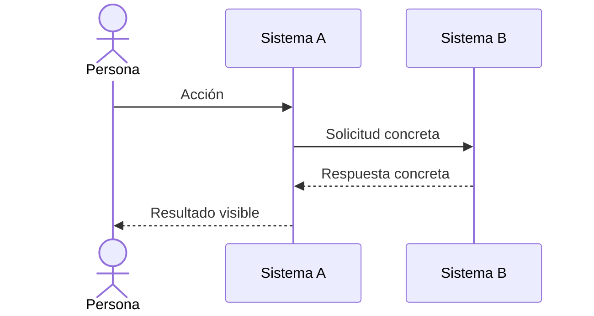
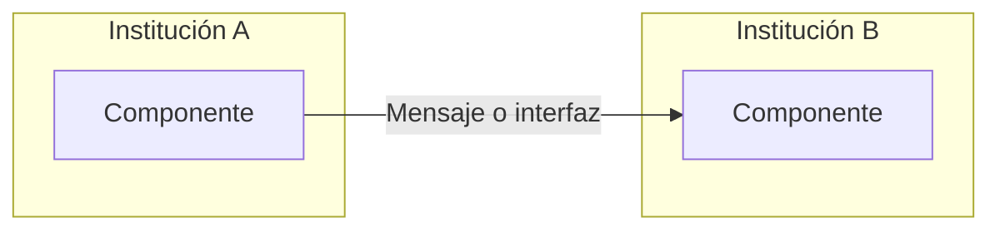
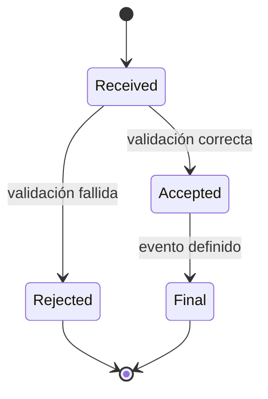

# Mermaid Templates

Mermaid is the review format, not the final editorial style. Keep drafts unthemed.

## Sequence: request and response



Use solid arrows for requests and dashed arrows for responses. Do not label either one “datos” or “dinero”.

## Topology: ownership and connections



Every subgraph is an actual ownership or operational boundary. Do not use subgraphs merely to decorate.

## State lifecycle



Use official state names in technical diagrams. Add plain-Spanish explanations in surrounding prose instead of renaming protocol states.

## Review note

Place this comment at the top of the Mermaid block in a new diagram document:

```text
%% Question: [the one question this diagram answers]
%% Channel: [messages | customer funds | obligations | BCE settlement | mixed, separated in lanes]
%% Audience: [editorial | technical | both]
```

If `Channel` is mixed, each channel must occupy a named lane or a separate diagram.
