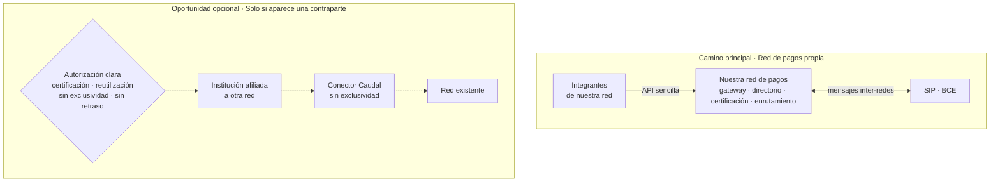

# Red propia y oportunidad de conectividad

**Pregunta:** ¿Cuál es el camino principal y cuándo considerar conectividad hacia una red existente?

**Canal representado:** mensajes. Las flechas no representan movimiento ni custodia de dinero.

**Estado:** aprobado el 18-08-2026 para el resumen ejecutivo institucional.

## Qué debe validar la revisión

- Si la red propia aparece inequívocamente como el camino principal.
- Si las responsabilidades resumidas dentro de la red son suficientes para un lector no técnico.
- Si la conectividad hacia otra red se entiende como oportunidad opcional, sin sugerir una transición de clientes ni una dependencia.
