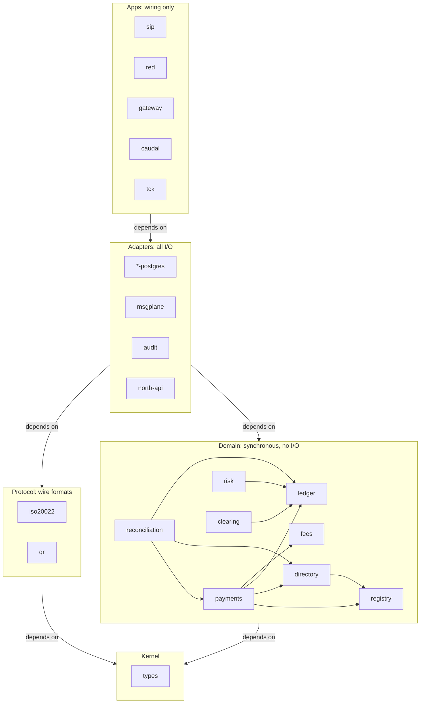

# Crate map

**Question:** Which crates may depend on which?
**Channel:** code dependencies only. No messages, obligations, customer funds or settlement are shown.
**Status:** draft for review.
**Source of truth:** [ADR-0012](../architecture/adr/0012-crate-boundaries.md). If this diagram and the ADR disagree, the ADR wins.

An arrow means "depends on". Every layer may also depend on the layers below it; only the edges between domain crates are drawn one by one.

## Review notes

- `protocol` and `domain` never depend on each other; adapters translate between them.
- `ledger` and `fees` depend only on the kernel. The ceiling is enforced inside `ledger` (ADR-0009); `risk` only funds it.
