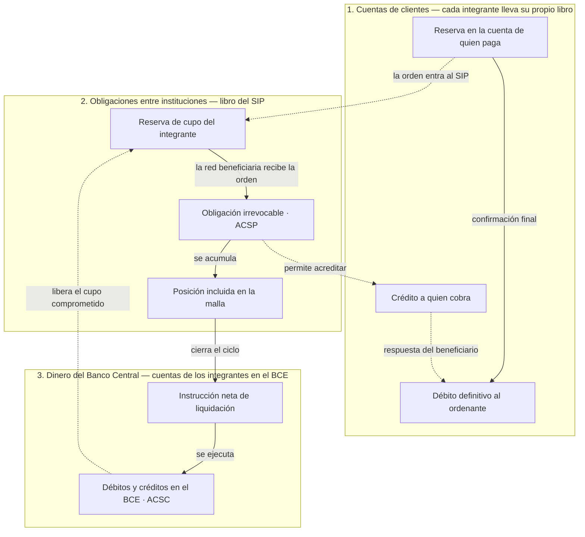

# Qué cambia cuando una persona paga

**Pregunta:** ¿Qué cambia cuando una persona paga y cuándo ocurre cada cambio?

**Canales representados:** cuentas de clientes, obligaciones entre instituciones y liquidación en dinero del Banco Central. Cada canal ocupa una franja separada.

**Estado:** borrador para revisión.

## Qué debe validar la revisión

- Si “débito definitivo” describe correctamente lo que el integrante hace con los fondos reservados al recibir la confirmación.
- Si la acreditación al beneficiario debe aparecer antes o después de `ACSP` en la explicación editorial.
- Si mostrar el retorno de cupo desde `ACSC` hace el diagrama más claro o introduce un ciclo difícil de leer.
