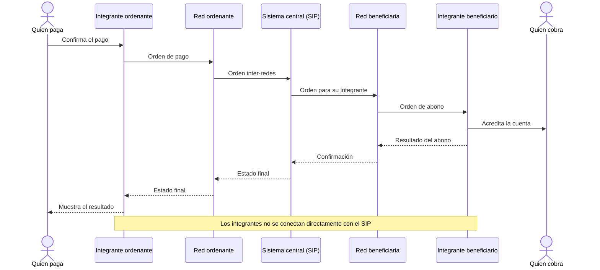

# Participantes de un pago inter-redes

**Pregunta:** ¿Quién se comunica con quién en un pago entre dos redes?

**Canal representado:** mensajes. Las flechas no representan movimiento de dinero.

**Estado:** aprobado el 18-08-2026 para el resumen ejecutivo institucional.

## Qué debe validar la revisión

- Si este nivel de detalle explica la topología sin entrar todavía en irrevocabilidad.
- Si conviene mostrar a las personas o comenzar y terminar en los integrantes.
- Si el pago dentro de una sola red merece un diagrama separado.
