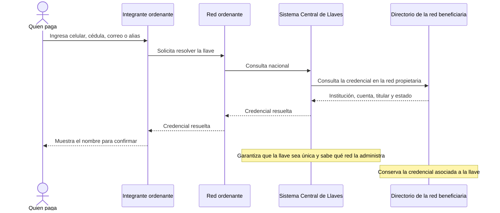

# Resolución de una llave

**Pregunta:** ¿Cómo se convierte una llave que una persona recuerda en una cuenta que puede confirmar?

**Canal representado:** mensajes de consulta y respuesta. No se mueve dinero durante este flujo.

**Estado:** borrador para revisión.

## Qué debe validar la revisión

- Si el Sistema Central de Llaves consulta directamente el directorio distribuido o si debemos mostrar a la red beneficiaria como participante separado.
- Qué datos necesita ver el lector y cuáles pertenecen únicamente a la especificación técnica.
- Si registro y resolución de llaves deben explicarse en diagramas distintos.
