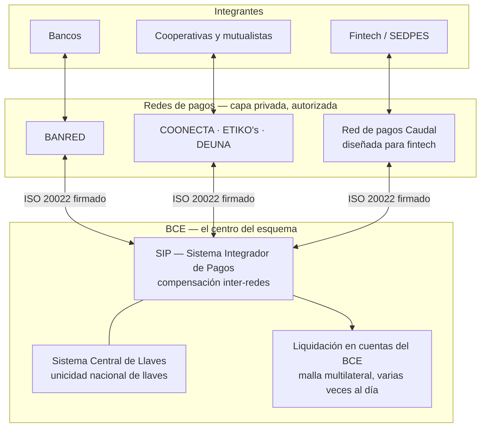
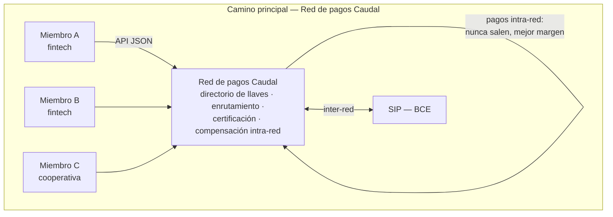
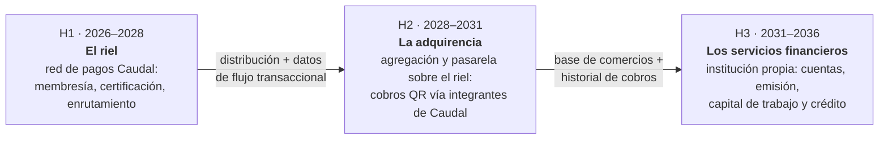

# Red de pagos Caudal — Plan de negocio para fintech en Ecuador

## 1. Resumen

Estamos construyendo la **red de pagos Caudal** para empresas que quieren mover su negocio más rápido. La sociedad operadora de Caudal prestará servicios a fintech, cooperativas y bancos para conectarlos al Sistema Integrador de Pagos (SIP) del Banco Central del Ecuador. Administrará el enrutamiento, la certificación y la compensación intra-red, y remitirá las posiciones para su liquidación por el BCE, con un enfoque moderno, eficiente y seguro.

## 2. Oportunidad

Ecuador es uno de los últimos países en la región que no cuenta con una red de pagos verdaderamente interoperable. Esta es una necesidad latente para la sociedad y desde fines de 2024 y comienzos de 2026 (JPRM-2024-018-M, JPRM-2024-029-M, BCE-GG-008-2025, BCE-GG-007-2026) diferentes reguladores han publicado normas, decretos y articulos que ordenan la interoperabilidad de pagos en tiempo real a los participantes del sistema financiero.

Los hechos:

- **Plazo: 30 de noviembre de 2026**: toda red y todo integrante debe utilizar el esquema ISO 20022 para pagos en tiempo real intra-red. Unos 24 bancos, más de 365 cooperativas, mutualistas y fintech lo enfrentan casi sin herramientas locales.
- La arquitectura es **multi-red** (como Bre-B en Colombia): _redes de pagos_ privadas enrutan los pagos y administran directorios de llaves; el SIP del BCE compensa entre ellas. La capa de redes está **abierta a nuevos entrantes por autorización** y existen cuatro identificadas en el Catálogo: BANRED, COONECTA, ETIKO's y DEUNA.
- Las fintech (SEDPES) están contempladas expresamente como integrantes (JPRM-2024-029-M, art. 48.6). **[supuesto comercial]** Pueden estar insuficientemente atendidas por ofertas diseñadas originalmente para bancos o cooperativas; esta hipótesis debe validarse con entrevistas, tiempos de integración y precios reales.
- Ecuador está **dolarizado** y registró unas 11 transferencias cuenta-a-cuenta por habitante en 2022 — de lo más bajo de la región (Brasil ~200, Colombia 36). Ese margen de adopción es toda la historia: cuando el riel funciona, el volumen se multiplica por 10 o 30. Pasó en Brasil (Pix: de 0 a 5.000 millones de transacciones mensuales en 4 años) y en Colombia (Bre-B: 370 millones de transacciones en menos de 4 meses).

La ventana: la autorización y la confianza son el foso competitivo, y construirlo cuesta menos **ahora**, antes de que el riel esté en producción y mientras todas las instituciones corren contra el plazo.

### Sistema Integrado de Pagos - Visualmente

Cuando ordenante y beneficiario pertenecen a redes diferentes, el pago viaja **integrante → red de pagos → SIP → red de pagos → integrante**: los integrantes no se integran directamente con el SIP (BCE-GG-007-2026, art. 3; Catálogo Operacional §2). Los pagos entre dos miembros de una misma red no salen al SIP. La red es la infraestructura común en ambos casos — y por eso administrarla es la posición estructural del esquema.

Cada red administra un grupo de llaves de sus integrantes, sincronizado en tiempo real con el Sistema Central de Llaves, y es responsable de **certificar** técnicamente a sus miembros antes de que operen. Este rol de responsable de certificación es el rol de guardián que vuelve el negocio recurrente protegido por la norma.

### Complejidad técnica para Entidades Financieras

La fintech o cooperativa no tiene la facultad de conectarse directamente al SIP, sino que debe conectarse a una red de pagos y esta asume la relación con el SIP. Pero construir y operar correctamente el lado del integrante sigue siendo un proyecto especializado. No es una integración sencilla, y las entidades financieras necesitan especialistas para hacerlo correctamente. El integrante debe sostener una integración que procesa dinero en tiempo real, supera una calificación técnica y puede evidenciar cada pago, con toda su auditoría tanto a la contraparte como al regulador.

| Exigencia                             | Lo que significa en la práctica para el integrante                                                                                                                                                                                                                                                                                                                                                |
| ------------------------------------- | ------------------------------------------------------------------------------------------------------------------------------------------------------------------------------------------------------------------------------------------------------------------------------------------------------------------------------------------------------------------------------------------------- |
| **Mensajería ISO 20022**              | Generar, validar y mantener mensajes `pacs.008`, `pacs.002` y `acmt.*` con sus estados, rechazos y correlaciones correctas. Un cambio de versión o una validación mal aplicada no es un error de interfaz: puede dejar un pago por conciliar.                                                                                                                                                     |
| **Tiempos e irrevocabilidad**         | El esquema impone un máximo de 20 segundos desde la iniciación hasta la confirmación y 60 segundos para que el cliente confirme después de resolver una llave. Hay que presupuestar cada salto, distinguir un timeout de un rechazo y no liberar fondos si el pago ya se volvió irrevocable.                                                                                                      |
| **Disponibilidad y resiliencia**      | El SIP opera 24/7 y el pago no espera una ventana de mantenimiento (Catálogo Operacional §2). La institución necesita alta disponibilidad, recuperación ante fallas, monitoreo de contraparte, conciliación de excepciones y procedimientos que funcionen a las tres de la mañana, no solo un entorno de pruebas.                                                                                 |
| **Seguridad y trazabilidad**          | La BCE-GG-008-2025, art. 10 exige confidencialidad, integridad, disponibilidad, autenticidad y trazabilidad, con cifrado, autenticación fuerte, gestión de vulnerabilidades, monitoreo, continuidad y recuperación. Los estándares detallados de conexión y el catálogo técnico todavía no están publicados; por ello una integración propia también carga con una dependencia externa cambiante. |
| **Calificación y operación continua** | Antes de operar, la red debe certificar al miembro; después, cada incidente, cambio de versión, certificado vencido o pago por conciliar requiere evidencia, coordinación y respuesta. La calificación del BCE además verifica que el servicio real coincida con el expediente (BCE-GG-024-2024, art. 12).                                                                                        |

Esa carga no desaparece: se concentra donde hay especialistas. El conector de Caudal convierte la interfaz del miembro en una API JSON estable, preserva el aislamiento por cliente y opera la mensajería, los límites de tiempo, la observabilidad y las corridas de conformidad como un servicio. El integrante conserva sus responsabilidades —validar al cliente y su cuenta, autorizar el pago, administrar su riesgo y atenderlo—; la sociedad operadora de Caudal absorbe la complejidad de infraestructura compartida. Esa es la razón económica de pagar por conectividad y certificación, y no solo una mejor experiencia para desarrolladores.

## 3. Casos de Exito Regionales

| Empresa            | País              | Modelo                                                                                                    | Prueba                                                                                                                                                                                                                                     |
| ------------------ | ----------------- | --------------------------------------------------------------------------------------------------------- | ------------------------------------------------------------------------------------------------------------------------------------------------------------------------------------------------------------------------------------------ |
| **STP**            | México            | Conectividad directa al SPEI para empresas; tarifa fija por transacción, escalonada por volumen           | Atiende a más de 1.500 empresas, incluido **el 95–98% de las fintech mexicanas**; procesó 2.800 millones de transferencias en 2022; se volvió _la_ utility fintech de México solo con conectividad                                         |
| **Celcoin**        | Brasil            | BaaS / infraestructura Pix (la ruta de participante indirecto → directo como producto)                    | **USD 63 millones de ingreso recurrente anual** (T1 2024, +140% interanual); más de 250 millones de transacciones Pix al mes; ronda de USD 125 millones liderada por Summit Partners                                                       |
| **Transfeera**     | Brasil            | Infraestructura de pagos → licencia de institución de pago → **participante directo de Pix** (enero 2025) | Llegó a participante directo y a ~R$ 19 millones de ingresos / R$ 12.800 millones procesados (2022) con **~R$ 17 millones de financiamiento en toda su vida** — la versión eficiente en capital de esta jugada; adquirida por PayRetailers |
| **Minka**          | Colombia          | La infraestructura detrás de **Transfiya** (ACH Colombia); hoy impulsa la transición a Bre-B              | Más de 40 millones de transacciones mensuales, ~10 millones de usuarios al mes, disponibilidad de cinco nueves; USD 27,5 millones levantados (Tiger, Kaszek); SaaS transaccional para cámaras de compensación                              |
| **Mono**           | Colombia          | APIs de finanzas embebidas, incluidos pagos inmediatos por Bre-B                                          | Respaldada por YC, ~USD 7 millones levantados, **punto de equilibrio con USD 1–4 millones de ingresos y un equipo de 25–30 personas** — la prueba de que la versión austera funciona                                                       |
| **Conekta / Bold** | México / Colombia | Pagos del lado del comercio (pasarela / adquirencia)                                                      | Conekta: USD 15.000 millones procesados, ~180 personas. Bold: 150.000 comercios pero **800 empleados** — el modelo intensivo en gente que explícitamente _no_ vamos a construir                                                            |

Tres lecciones: (1) **los negocios de conectividad al riel se vuelven utilities nacionales** — STP es dueña de la conectividad fintech de México, Celcoin del Pix embebido en Brasil; (2) **la licencia es el foso** — el salto de valor de Transfeera llegó con la participación directa; (3) **la nómina es una decisión** — Bold necesitó 800 personas para adquirencia; las empresas de infraestructura con distribución por API (Mono, Transfeera) operan con 10–30 veces menos. Ecuador en 2026 es Brasil en 2019 o Colombia en 2023, con **cero** incumbentes de infraestructura nativa para fintech.

## 4. Estrategia

**La apuesta (ahora – mediados de 2027): autorizar y lanzar la red de pagos Caudal.** La estrategia regulatoria por validar es solicitar procesamiento + switch transaccional + compensación en un mismo expediente y completar la calificación técnica y operativa de la red — ver [`plan.md`](plan.md). Fintech y cooperativas firman como futuros integrantes y se preparan mediante el sandbox, la API y las corridas de conformidad antes de que se habiliten pagos reales.

**Red de pagos Caudal, diseñada para fintech.** Su sociedad operadora administrará el directorio de llaves, enrutará pagos desde y hacia el SIP, certificará a los integrantes y compensará el tráfico intra-red para remitir las posiciones al BCE. La sociedad operadora fijará las tarifas de membresía, certificación y enrutamiento. Cada fintech que firma vuelve la membresía más valiosa para la siguiente.

**Conector de Caudal hacia una red existente: oportunidad, no estrategia.** Si una institución o una red solicita usar esta capa de integración, la sociedad operadora de Caudal puede evaluarlo siempre que exista autorización clara, la contraparte certifique la conexión, el trabajo sea reutilizable y el contrato no imponga exclusividad ni dificulte que la institución elija la red Caudal después. La sociedad no prospecta esta oferta, no la incluye como ingreso asegurado y no retrasa por ella el expediente ni la construcción de la red.

**La expansión (2029 en adelante): la capa de productos del riel.** Solicitud de pago, dispersiones masivas, monitoreo de liquidez y herramientas de riesgo para los miembros (el techo del BCE golpeará más duro a las SEDPES — Catálogo §10), productos de datos y, opcionalmente, la jugada de Minka: licenciar la plataforma a redes y cámaras de otros países que adopten estándares al estilo Bre-B. El núcleo está diseñado por perfiles; Ecuador es el perfil #1.

### Convirtiéndonos en la red de pago del futuro

Bold y Conekta no son competidores de Caudal — son un ejemplo de a dónde puede llegar con ejecución efectiva. **Bold** arrancó con datáfonos, consiguió su aprobación como institución financiera en Colombia en 2023 y hoy les vende a sus 150.000 comercios cuentas, tarjetas de débito y crédito de capital de trabajo: multiplicó sus ingresos por seis en dos años al subir de escalón. **Conekta** pasó de pasarela a consolidar todos los métodos de pago de México en una sola integración. La lección es su **secuencia de licencias**. La infraestructura de pagos es la puerta de entrada; el margen crece subiendo la escalera con la base de clientes y los datos transaccionales ya montados.

| Horizonte                                      | Qué somos                                                                                                                | Licencia que exige                                                                                                                                                 | Referente                                              |
| ---------------------------------------------- | ------------------------------------------------------------------------------------------------------------------------ | ------------------------------------------------------------------------------------------------------------------------------------------------------------------ | ------------------------------------------------------ |
| **H1 — El riel** (2026–2028)                   | Membresía, conectividad, certificación y enrutamiento mediante la red Caudal                                             | BCE: autorización en los servicios aplicables y calificación técnica y operativa de la red                                                                         | STP, Transfeera                                        |
| **H2 — La adquirencia** (2028–2031)            | Agregación y pasarela de pagos sobre el riel: los comercios cobran con QR mediante integrantes de Caudal                 | **Extensión de la misma autorización**: agregación de pago y pasarela son categorías del mismo art. 23 (JPRM-2024-018-M) — mismo regulador, expediente incremental | Conekta; Bold en su primera fase                       |
| **H3 — Los servicios financieros** (2031–2036) | Institución propia: cuentas, emisión de tarjetas, capital de trabajo y crédito suscrito con los datos de flujo de la red | SEDPE o entidad financiera — **régimen nuevo** (JPRF / Superintendencia), capital propio, custodia                                                                 | Bold tras su licencia de 2023; STP como IFPE en México |

Cada horizonte financia y desriesga el siguiente: H1 construye la distribución (los miembros) y el activo de datos (el flujo transaccional del país pasa por la red); H2 monetiza a los comercios que ya cobran por el riel; H3 monetiza el balance — crédito suscrito con datos de flujo reales, el mismo camino que convirtió a Bold de vendedor de datáfonos en entidad financiera. Dos honestidades para el inversionista: el modelo financiero de §6 cubre **solo H1 y el arranque de H2** (H3 es opcionalidad, no proyección), y H3 implica custodiar fondos y prestar — otro régimen de capital y supervisión, y una decisión societaria separada del proyecto abierto Caudal, cuyas reglas (sin custodia, sin paywall al cumplimiento) no cambian.

## 5. Modelo de Negocios

| Bloque                    | Contenido                                                                                                                                                                                                                                                                                                                                                                                                                 |
| ------------------------- | ------------------------------------------------------------------------------------------------------------------------------------------------------------------------------------------------------------------------------------------------------------------------------------------------------------------------------------------------------------------------------------------------------------------------- |
| **Segmentos de clientes** | (1) **Fintech y SEDPES** — licenciadas o en camino a la licencia — que necesitan entrar al riel (primario). (2) **Cooperativas** de segmentos 1–3, alcanzadas vía cajas centrales y proveedores de core bancario (secundario). (3) **Empresas con tesorería intensiva** — nómina, comisiones, marketplaces, aseguradoras — que usan el conector de Caudal como capa de tesorería _a través de_ un integrante (terciario, B2B2B; ver §6) |
| **Propuesta de valor**    | Incorporación a una red diseñada para fintech mediante una API sencilla, certificación reproducible, operación 24/7 y monitoreo de liquidez, sin que cada institución tenga que construir sola la capa ISO 20022. El tiempo y costo deben validarse frente a las ofertas existentes antes de presentarlos como ventaja.                                                                                                   |
| **Canales**               | El proyecto abierto Caudal y su documentación (el mejor material en español sobre el estándar = inbound), el **Catastro público del BCE** (la lista de prospectos está publicada), la AEFI y la comunidad fintech, cajas centrales y proveedores de core como distribución (una integración = decenas de instituciones), los foros de interoperabilidad, venta directa del fundador                         |
| **Relación con clientes** | Autoservicio primero (sandbox, SDKs, documentación); soporte con agentes sobre el corpus de la norma; acompañamiento humano en certificación y cuentas grandes; comunidad open source                                                                                                                                                                                                                                     |
| **Fuentes de ingreso**    | SaaS con subscripción mensual por cliente + tarifa fija por transacción. El costo de la certificación (USD 5–15 mil) o aceleración para SEDPE (USD 25–50 mil); membresía y enrutamiento de la red.                                                                                                                                                                                                                        |
| **Recursos clave**        | La **autorización del BCE** (el foso), la implementación de referencia Apache-2.0 en construcción, el corpus decodificado de la norma, el equipo senior apalancado en agentes y los contratos de adhesión firmados                                                                                                                                                                                                        |
| **Actividades clave**     | Operar el riel 24/7 con la disciplina de §7; certificar y hacer onboarding de miembros; cumplimiento y reportes al BCE y la UAFE; desarrollo de producto sobre el riel; la relación regulatoria continua                                                                                                                                                                                                                  |
| **Socios clave**          | El BCE (regulador y operador del SIP); cajas centrales y federaciones (RFEC, UCACSUR); proveedores de core bancario; la AEFI; los abogados regulatorios; la cámara especializada; la comunidad del proyecto abierto Caudal                                                                                                                                                                                                |
| **Estructura de costos**  | Nómina pequeña y senior (el mayor rubro, ~65% — §8); infraestructura y seguridad (nube, HSM, certificados, auditorías); legal y cumplimiento; sin fuerza de ventas masiva ni centro de soporte — esa es la apuesta de §7                                                                                                                                                                                                  |

## 6. Cliente ideal y cómo lo encontramos

**Primero, la frontera regulatoria que ordena todo**: al riel solo se conectan **integrantes autorizados** — instituciones financieras, SEDPES y procesadores calificados (JPRM-2024-018-M, art. 22). Pero _venderle tecnología_ no tiene esa frontera: una empresa cualquiera puede usar el conector de Caudal como software de tesorería siempre que el dinero se mueva por la cuenta de un integrante. Tres perfiles, tres relaciones distintas con el riel:

| Perfil                                                | Quién es                                                                                                                                                | Su dolor                                                                                                     | Cómo se conecta                                                                                                                                                                                                                     | Cómo lo encontramos                                                                                                                                                                                           |
| ----------------------------------------------------- | ------------------------------------------------------------------------------------------------------------------------------------------------------- | ------------------------------------------------------------------------------------------------------------ | ----------------------------------------------------------------------------------------------------------------------------------------------------------------------------------------------------------------------------------- | ------------------------------------------------------------------------------------------------------------------------------------------------------------------------------------------------------------- |
| **ICP primario: la fintech en camino al riel**        | Fintech ecuatoriana o regional, equipo API-native, SEDPE licenciada o en trámite; necesita cash-in/cash-out en tiempo real para su producto             | Sin acceso directo al riel; los bancos le dan APIs lentas, caras o ninguna; el trámite SEDPE le queda grande | Como **integrante de la red Caudal**, con contrato condicionado a la autorización mientras completa su propia habilitación                                                                                                          | El **Catastro del BCE es público**: las SEDPES y aspirantes están listadas con nombre. Más la AEFI, la red YC/fintech regional, y el inbound de Caudal                                                        |
| **ICP secundario: la cooperativa contra el plazo**    | Cooperativa de segmento 1–3 (o su caja central / proveedor de core) que debe cumplir el 30-nov-2026 y no tiene equipo de pagos                          | El plazo regulatorio es existencial; no puede construir ISO 20022 ni pagar una integración de un año         | Como **integrante de la red Caudal**; su caja central o proveedor de core puede distribuir e integrar el conector, y solo operarlo si cuenta con la autorización aplicable                                                          | Por el multiplicador: federaciones (RFEC, UCACSUR), cajas centrales y los 3–4 proveedores de core que concentran cientos de cooperativas. Una firma = decenas de instituciones                                |
| **ICP terciario: la empresa con tesorería intensiva** | Empresa que dispersa nómina o comisiones, concilia cobranza masiva, o mueve fondos entre cuentas todos los días (marketplaces, aseguradoras, logística) | Tesorería manual sobre portales bancarios; conciliación en hojas de cálculo; pagos que demoran días          | **No es integrante**: usa la API del conector de Caudal (dispersiones ≤ USD 15.000 por pago, cobros, conciliación) con su cuenta y su KYC en un integrante. Una cuenta directa requeriría la licencia SEDPE de H3               | A través de los integrantes, gremios empresariales y el caso de uso publicado — el mismo camino con el que STP llegó a automatizar la tesorería de 1.500 empresas mexicanas                                  |

**La mecánica de adquisición, en orden de rendimiento esperado**: (1) la **precertificación como puerta de entrada** — un informe de conformidad hoy reduce el trabajo de incorporación y puede convertirse en membresía cuando la red esté autorizada; (2) el **contenido en español** que ya existe (el análisis del estándar es el mejor material público del país y los prospectos lo encuentran buscando cómo cumplir); (3) los **multiplicadores** — cajas centrales y proveedores de core — donde una relación abre decenas de clientes; (4) los **foros de interoperabilidad**, donde están sentados todos los obligados; (5) venta directa del fundador sobre la lista del Catastro. La meta en [`commercial/pipeline.md`](commercial/pipeline.md) es obtener 2–3 compromisos comerciales; solo cuentan para el expediente los contratos cuya contraparte y alcance satisfagan el requisito del servicio solicitado.

## 7. El modelo operativo con agentes de IA (por qué esto es 10 veces más austero)

Esta es la ventaja estructural de costos, y viene de fábrica, no de parche. La escala nacional del Ecuador lo permite: un país tres veces más grande alcanza picos de ~60 transacciones por segundo a nivel nacional — **el problema de ingeniería es la corrección y la disponibilidad, no el volumen**. Y esa es exactamente la forma de problema donde un equipo pequeño y senior con agentes de IA le gana a un equipo grande.

| Función                     | Operador de pagos tradicional                                                       | Caudal (nativo en agentes)                                                                                                                                                                                                                                                                                                                                      |
| --------------------------- | ----------------------------------------------------------------------------------- | --------------------------------------------------------------------------------------------------------------------------------------------------------------------------------------------------------------------------------------------------------------------------------------------------------------------------------------------------------------- |
| **Ingeniería**              | 20–40 ingenieros; el conocimiento de la norma en las cabezas; meses por integración | 3–5 ingenieros senior revisando código producido por agentes. El repositorio ya está optimizado para agentes: la norma nacional está decodificada en documentos estructurados, las skills dirigen a los agentes al contexto, y las pruebas con archivos dorados hacen verificable la corrección. El corpus de la norma _es_ el prompt                           |
| **Operación / NOC**         | Turnos 24/7 de 8–12 personas                                                        | 2–3 personas + agentes. Los agentes hacen el triaje del monitoreo, el cierre diario de conciliación de las 18:00 (clasificar, cruzar contra la información del SIP, proponer resoluciones), la vigilancia de umbrales de liquidez de los miembros y la ejecución de runbooks. **Una persona aprueba todo lo que mueva plata o suspenda a un miembro — siempre** |
| **Soporte e incorporación** | Equipos de soporte + semanas de pruebas de certificación agendadas por miembro      | Autoservicio primero: sandbox idéntico a producción, SDKs generados y soporte con agentes apoyado en la documentación de Caudal. Para certificarse, el integrante ejecuta el kit de conformidad y una persona firma la atestación regulada                                                                                                                        |
| **Cumplimiento y reportes** | Un equipo armando evidencia a mano                                                  | Reportes al BCE redactados por agentes desde la bitácora de auditoría inmutable y encadenada; los paquetes de evidencia para la supervisión (in situ y extra situ, BCE-GG-024-2024 arts. 15–17) se mantienen al día de forma continua; el corpus de políticas alineadas con ISO se mantiene como código                                                         |

Salvaguardas (lo que un inversionista debe escuchar junto a "austero"): los agentes nunca ejecutan por sí solos acciones que muevan dinero, suspendan miembros o emitan certificaciones; cada acción de un agente queda en la misma bitácora de auditoría que las humanas; las firmas reguladas son siempre de personas. La austeridad viene de que los agentes hacen la _lectura, redacción, triaje y vigilancia_ — el 80% de la nómina de un operador de pagos, que es trabajo de patrones sobre documentos y colas.

**Meta de eficiencia**: más de USD 300 mil de ingreso por empleado al año 3, más de USD 400 mil al año 5 — contra USD 100–150 mil típicos en la fintech latinoamericana. El punto de equilibrio de Mono con ~30 personas y la ruta de capital de Transfeera muestran la dirección; los agentes corren la frontera más allá.

## 6. Modelo financiero **[est.]**

### Tamaño de mercado (de abajo hacia arriba, conservador)

Ecuador: ~18 millones de habitantes, ~200 millones de transferencias cuenta-a-cuenta al año en el riel actual. Rampa modelada de volumen nacional en tiempo real (muy por debajo de las trayectorias de Pix y Bre-B): ~30 millones de transacciones en 2027 → 120 M (2028) → 300 M (2029) → 500 M (2030) → 750 M (2031). Participación de los integrantes de Caudal en el volumen nacional: 3% → 6% → 10% → 12% → 15% (primero fintech, luego la cola larga de cooperativas).

### Líneas de ingreso

1. **SaaS de conectividad**: USD 500–3.000 mensuales por cliente según tamaño (al estilo STP: además una tarifa fija por transacción, escalonada por volumen, de ~USD 0,02–0,05 — nunca un porcentaje del monto).
2. **Certificación y servicios de cumplimiento**: USD 5–15 mil por certificación; proyectos de aceleración SEDPE de USD 25–50 mil.
3. **Membresía y enrutamiento de la red** (desde la autorización): cuota de membresía + tarifa por transacción enrutada; el tráfico intra-red con mejor margen que el inter-red.
4. **Año 4 en adelante**: herramientas de liquidez y riesgo, solicitud de pago y dispersiones, licenciamiento regional.

### Proyección a cinco años (miles de USD, años calendario)

|                                                                   | 2027      | 2028      | 2029       | 2030       | 2031       |
| ----------------------------------------------------------------- | --------- | --------- | ---------- | ---------- | ---------- |
| Clientes / miembros                                               | 8         | 25        | 45         | 65         | 85         |
| Transacciones de miembros (M)                                     | 1         | 7         | 30         | 60         | 110        |
| SaaS + membresías                                                 | 150       | 500       | 950        | 1.400      | 1.900      |
| Tarifas por transacción                                           | 30        | 250       | 950        | 1.800      | 3.000      |
| Servicios (certificación, SEDPE, herramientas)                    | 150       | 300       | 400        | 600        | 1.100      |
| **Ingresos**                                                      | **330**   | **1.050** | **2.300**  | **3.800**  | **6.000**  |
| Equipo (personas)                                                 | 5         | 8         | 11         | 14         | 17         |
| Nómina (costo total)                                              | 380       | 620       | 880        | 1.200      | 1.500      |
| Infraestructura y seguridad (nube, HSM, certificados, auditorías) | 60        | 110       | 170        | 230        | 300        |
| Legal, cumplimiento, regulatorio                                  | 90        | 90        | 110        | 130        | 160        |
| Otros (oficina, seguros, administración)                          | 70        | 100       | 140        | 180        | 240        |
| **Costos**                                                        | **600**   | **920**   | **1.300**  | **1.740**  | **2.200**  |
| **EBITDA**                                                        | **(270)** | **+130**  | **+1.000** | **+2.060** | **+3.800** |
| Ingreso por empleado                                              | 66        | 131       | 209        | 271        | 353        |

Punto de equilibrio dentro de 2028; margen EBITDA de ~60% en 2031 — el perfil de márgenes que los agentes hacen posible. Escenario optimista (adopción al estilo Pix, el segmento cooperativo entra, una licencia regional): ingresos 2031 de USD 12–18 millones. Escenario pesimista (el SIP se atrasa un año): los servicios sostienen 2027–28; la presión del plazo que empuja los servicios _aumenta_ con el atraso.

### Lo que se pide

**Ronda semilla de USD 1,2–1,5 millones** para ~24 meses: completar las dos autorizaciones del BCE (~USD 150 mil en legal y regulatorio), financiar el equipo hasta el punto de equilibrio (~USD 900 mil) y montar la infraestructura de grado 24/7 (~USD 200 mil). Estructura alternativa: socios estratégicos (una caja central, un grupo fintech o un partícipe ya establecido) que aporten capital + los primeros contratos de adhesión — que además son requisito de la solicitud (BCE-GG-024-2024, art. 6.2).

## 7. Equipo

**Sebastián Alvarado — fundador y CTO.** Más de diez años construyendo infraestructura financiera:

- **Shopify (Financial Services), actual**: lidera el **Shopify Ledger**, el libro contable que procesa **miles de millones de dólares en transacciones al día** — exactamente la disciplina de ledger de doble entrada, conciliación e invariantes que exige operar una red de pagos.
- **Valari (Y Combinator)**: tres años construyendo **banking as a service en México** — el mismo modelo de negocio de este plan (infraestructura financiera por API para terceros), en el mercado donde STP demostró la categoría.
- **Relay (relayfi.com)**: banca empresarial en Norteamérica; arquitectura de sistemas escalables en la nube para servicios financieros en producción.

El perfil cubre las tres competencias críticas del negocio: sistemas de pago a escala (Shopify), infraestructura financiera regulada como producto (Valari) y operación en la nube de grado bancario (Relay). Además, es el autor del análisis público del estándar ecuatoriano y de la implementación de referencia sobre los que se construyen Caudal y su futura sociedad operadora (ver §8).

**Contrataciones clave del primer año** (equipo de 5 en 2027, según el modelo financiero): una persona senior de **regulatorio y cumplimiento** en Quito (la contraparte diaria ante el BCE y la UAFE), dos **ingenieros senior** para el núcleo de pagos y la operación 24/7 con agentes, y un perfil **comercial** para la cartera de contratos de adhesión. El directorio se complementa con un asesor legal-regulatorio y un asesor del sector cooperativo/fintech ecuatoriano.

## 8. Por qué Caudal

1. **Ventaja regulatoria**: el análisis público más profundo que existe del estándar ecuatoriano (el resumen del catálogo operacional, la cartera de RFC y las preguntas al BCE), desarrollado por Caudal.
2. **La base técnica existe**: corpus normativo, modelo de dominio, decisiones de arquitectura y módulos iniciales de ledger, compensación, riesgo y tarifario. El conector de Caudal, el perfil ISO 20022 completo y la operación de red todavía deben construirse y demostrarse.
3. **Nativos en agentes desde el día cero**: el código, la documentación y la operación están estructurados para apalancar agentes (skills, corpus de la norma, archivos dorados) — no es un parche posterior.
4. **El momento**: presentamos el expediente mientras todas las instituciones del país miran fijo el 30 de noviembre de 2026.

## 9. Riesgos principales (con respuestas honestas)

| Riesgo                                                             | Mitigación                                                                                                                                                          |
| ------------------------------------------------------------------ | ------------------------------------------------------------------------------------------------------------------------------------------------------------------- |
| El BCE se demora más de lo previsto                                | Presentar completo y temprano; sostener ingresos con software, sandbox, precertificación y acompañamiento sin operar pagos reales                                   |
| Las redes existentes mejoran su oferta o compiten por fintech      | Validar con clientes una ventaja material en incorporación, costo y operación; no asumir que el segmento está desatendido ni que los incumbentes no pueden servirlo |
| El cronograma del SIP se atrasa                                    | Los servicios y la demanda del plazo intra-red no dependen de la salida del SIP; el atraso alarga la ventana de servicios                                           |
| La liquidación intra-red no está documentada (pregunta abierta P4) | Planteada formalmente al BCE; el ledger y la compensación del repositorio resuelven cualquiera de los dos desenlaces                                                |
| Fragilidad de equipo pequeño / personas clave                      | Es la otra cara del modelo con agentes; se mitiga con el corpus abierto (nada existe solo en cabezas) y contratando seniority                                       |
| Objeción regulatoria a procesos operados por agentes               | Las salvaguardas de arriba; las personas firman todo lo regulado; la bitácora de auditoría cubre también a los agentes — listos para la supervisión por diseño      |
