# Red de pagos Caudal — Ruta operativa de autorización y conexión

**Uso:** guía interna de ejecución  
**Fecha de corte:** 18-08-2026  
**Objetivo:** obtener la autorización necesaria para que la sociedad operadora de Caudal administre la red de pagos Caudal y complete su calificación técnica y operativa antes de conectarla al SIP.

Esta guía ordena el trabajo. La lista normativa exhaustiva permanece en [`dossier-psap.md`](dossier-psap.md), las incertidumbres jurídicas en [`open-questions.md`](open-questions.md) y la evidencia para la visita en [`../technical/readiness.md`](../technical/readiness.md).

> La autorización como partícipe del Sistema Auxiliar de Pagos y la calificación técnica y operativa de la red son dos puertas distintas. Obtener el acto administrativo no habilita por sí solo la conexión productiva al SIP.

## 1. La ruta completa

```mermaid
flowchart LR
    A["1 · Alcance legal<br/>servicios y sociedad"]
    B["2 · Habilitación societaria<br/>RUC · representante · accionistas"]
    C["3 · Dependencias externas<br/>auxiliar · UAFE · contratos · cámara"]
    D["4 · Expediente completo<br/>anexos · políticas · servicio demostrable"]
    E["5 · Calificación del BCE<br/>revisión · subsanación · debida diligencia · visita"]
    F["6 · Autorización<br/>acto administrativo · Catastro"]
    G["7 · Red en producción<br/>calificación técnica · pruebas · SIP"]

    A --> B --> C --> D --> E --> F --> G
```

| Puerta | Qué debe estar cerrado | Qué habilita |
|---|---|---|
| **Constituir** | Forma societaria, objeto social, servicios que se pretende solicitar y representante legal elegible | Crear la sociedad, obtener RUC y producir documentos a nombre de la solicitante |
| **Presentar** | Requisitos generales, requisitos por servicio, contratos elegibles, certificado UAFE, infraestructura y servicios demostrables | Ingreso formal de la solicitud al BCE |
| **Ser autorizado** | Revisión, debida diligencia, subsanaciones y visita técnica satisfactorias | Acto administrativo como partícipe para servicios, medios y canales determinados |
| **Operar la red** | Autorización en compensación, cámara especializada, calificación técnica y operativa, conectividad y pruebas | Conexión al SIP e inicio controlado de operaciones inter-red |

La base jurídica del objetivo es la JPRM-2024-029-M, art. 18.1.2: pueden administrar redes de pagos los partícipes previamente autorizados en **compensación** que procesan transferencias de pago. Antes de conectarse al SIP, la administradora debe obtener además la calificación técnica y operativa del BCE (BCE-GG-008-2025, art. 5).

## 2. Decisiones que deben cerrarse primero

Estas decisiones condicionan el objeto social, el expediente y los contratos. No deben quedar implícitas.

| Decisión | Posición de trabajo | Evidencia necesaria | Estado |
|---|---|---|---|
| Servicio que habilita la red | Solicitar **compensación** (JPRM-2024-029-M, art. 18.1.2) | Criterio jurídico y confirmación escrita de la secuencia con el BCE | ◐ |
| Solicitud de varios servicios | Evaluar una sola solicitud para compensación + procesamiento + switch; la BCE-GG-024-2024, art. 3.1, admite “el o los servicios” | Memorando de abogados que confirme conveniencia y requisitos activados | ⚠ |
| Procesamiento | Solo incluirlo si se resuelve la calificación auxiliar previa y existen contratos elegibles | Criterio del organismo de control + contratos del art. 5.2 | ⚠ |
| Switch transaccional | Incluirlo si corresponde al enrutamiento que operará la red y existen contratos con partícipes elegibles | Criterio jurídico + contratos y SLA del art. 6.2 | ⚠ |
| Forma y objeto social | Sociedad ecuatoriana o sucursal admitida, con objeto social exclusivo para las actividades fintech solicitadas | Estatuto revisado por abogados antes de constituir | ☐ |
| Cámara especializada | Confirmar acceso, garantías, documentación y orden respecto de la autorización | Respuesta escrita del BCE o de la cámara; el art. 9 exige cumplir antes de operar, no como condición expresa para presentar | ⚠ |

**Puerta de salida:** los abogados entregan una recomendación escrita que enumera servicios, fundamento, organismo competente, contratos necesarios y secuencia de trámites.

## 3. Los primeros diez días

Los primeros cuatro bloques son controlables. La calificación auxiliar, la UAFE, los contratos y la cámara se inician de inmediato, pero su duración depende de terceros.

| Momento interno **[est.]** | Acción | Evidencia | Responsable propuesto | Estado |
|---|---|---|---|---|
| Día 0–2 | Contratar asesoría especializada en medios de pago y entregar `open-questions.md` | Carta de encargo referenciada en el repositorio privado | Dirección | ☐ |
| Día 0–3 | Confirmar forma societaria, objeto social y servicios que cubrirá | Borrador de estatuto + matriz de servicios | Legal | ☐ |
| Día 1–4 | Verificar elegibilidad del representante legal antes del nombramiento | Lista de control de prohibiciones y certificados requeridos | Legal | ☐ |
| Día 1–5 | Definir accionistas y beneficiarios finales | Organigrama de propiedad hasta personas naturales | Dirección + Legal | ☐ |
| Día 2–7 | Constituir e inscribir la sociedad | Escritura, estatuto e inscripción registral | Legal | ☐ |
| Día 5–8 | Obtener RUC y nombramiento inscrito | RUC + nombramiento | Legal + Finanzas | ☐ |
| Día 1–10 | Abrir el índice del repositorio privado de evidencia | Inventario con dueño, fecha, vigencia y ubicación de cada documento | Operaciones | ☐ |
| Día 1–10 | Iniciar registro/certificado UAFE | Constancia del trámite | Cumplimiento | ⚠ |
| Día 1–10 | Consultar la calificación auxiliar para procesamiento | Consulta formal al organismo de control | Legal | ⚠ |
| Día 1–10 | Identificar contrapartes elegibles por servicio | Matriz de prospectos con categoría regulatoria verificada | Comercial + Legal | ◐ |
| Cerca de presentar | Obtener certificados del mes actual o anterior y otorgar declaraciones notariales | Paquete vigente del art. 3.2 | Legal | ☐ |

Los plazos de esta tabla son metas internas de organización, no términos regulatorios.

## 4. Matriz completa de prerrequisitos

Leyenda: ☐ sin empezar · ◐ en curso · ☑ listo · ⚠ bloqueado o externo.

### 4.1 Sociedad, personas y situación financiera

| # | Fuente | Requisito y evidencia | Responsable propuesto | Dependencia | Estado |
|---|---|---|---|---|---|
| 1 | BCE-GG-024-2024, art. 3.1 | Solicitud del Anexo 1, firmada por el representante legal, con cada servicio solicitado; anexos firmados y editables | Legal | Alcance de servicios cerrado | ☐ |
| 2 | Art. 3.2 | RUC de la entidad solicitante | Legal + Finanzas | Sociedad constituida | ☐ |
| 3 | Arts. 3.2.1–3.2.2 | Declaraciones juramentadas de la entidad y representante; certificados sobre moras, SRI, IESS, cuentas, contratación pública, organismo de control y antecedentes aplicables | Legal | Certificados vigentes del mes de presentación o anterior | ☐ |
| 4 | Art. 3.3 | Constitución, estatuto, objeto social e inscripción en el Registro Mercantil, organizados conforme al Anexo 4 | Legal | Forma y objeto validados | ☐ |
| 5 | Art. 3.4 | Nómina de accionistas y cadena de propiedad hasta personas naturales, conforme al Anexo 5 | Legal + Dirección | Estructura accionaria cerrada | ☐ |
| 6 | Art. 3.5 | Formulario “Conozca a su partícipe”, Anexo 6 | Cumplimiento | Información societaria y accionaria | ☐ |
| 7 | Art. 3.6 | Estados financieros firmados por representante y contador; si no ha iniciado operaciones, los del mes inmediato anterior | Finanzas | Sociedad y contabilidad activas | ☐ |
| 8 | Art. 3.7 | Auditoría externa solo para entidades con más de dos ejercicios fiscales de operación | Finanzas | No aplica a sociedad nueva | ☑ |
| 9 | Art. 3.8 | Lista de oficina matriz y puntos de atención, Anexo 7, más contratos de arriendo cuando correspondan | Operaciones | Espacio verificable en visita | ☐ |

### 4.2 Viabilidad y modelo operativo

| # | Fuente | Requisito y evidencia | Responsable propuesto | Dependencia | Estado |
|---|---|---|---|---|---|
| 10 | BCE-GG-024-2024, art. 3.9 | Plan de negocios, Anexo 8 | Dirección + Finanzas | Servicios y mercado definidos | ☐ |
| 11 | Art. 3.10 | Proyección financiera de viabilidad, factibilidad y sostenibilidad, Anexo 9 | Finanzas | Costos legales, técnicos y operativos estimados | ☐ |
| 12 | Art. 3.11 | Esquema operativo por servicio: actores, medios, canales, información, enrutamiento, conexiones, procesos y QR cuando aplique | Producto + Operaciones + Legal | Alcance por servicio | ☐ |
| 13 | Art. 3.12 | Capacidad, desempeño y diagrama de infraestructura tecnológica, Anexo 10 | Ingeniería | Arquitectura desplegable y dimensionada | ☐ |
| 14 | Art. 3.13 | Contratos con proveedores críticos de nube, red, seguridad y software; documentos extranjeros apostillados y traducidos | Operaciones + Legal | Proveedores seleccionados | ☐ |

### 4.3 Riesgos, gobierno, atención y datos

| # | Fuente | Requisito y evidencia | Responsable propuesto | Dependencia | Estado |
|---|---|---|---|---|---|
| 15 | BCE-GG-024-2024, art. 3.14 | Certificación ISO 31000 o metodología documentada de riesgo operativo y Anexo 11 | Riesgos | Procesos y responsables definidos | ☐ |
| 16 | Art. 3.15 | Metodología de riesgo de liquidez: indicadores, umbrales, apetito, tolerancia y acciones ante déficit | Riesgos + Operaciones | Modelo de compensación y alertas | ☐ |
| 17 | Art. 3.16 | Certificación ISO 27001 o políticas y procedimientos de seguridad alineados con estándares internacionales, Anexo 12 | Seguridad | Arquitectura y controles implementados | ☐ |
| 18 | Art. 3.17 | Certificación ISO 22301 o plan de continuidad, Anexo 13 | Operaciones + Seguridad | RTO/RPO, respaldos y recuperación probados | ☐ |
| 19 | Art. 3.18 | Manual de Buen Gobierno Corporativo, Anexo 14 | Dirección + Legal | Órganos y delegaciones definidos | ☐ |
| 20 | Art. 3.19 | Manual de atención: canales, reclamos, controversias, escalamiento y tiempos | Operaciones + Legal | Modelo de atención y SLA | ☐ |
| 21 | Art. 3.20 | Contratos de adhesión con proveedores relacionados con el servicio y sus anexos | Legal + Operaciones | Proveedores críticos seleccionados | ☐ |
| 22 | Art. 3.21 | Calificación como entidad de servicios auxiliares cuando corresponda | Legal | Organismo y aplicabilidad por confirmar | ⚠ |
| 23 | Art. 3.22 | Política de protección de datos conforme a la LOPDP y su Reglamento, Anexo 15 | Privacidad + Seguridad | Inventario y flujos de datos | ☐ |
| 24 | Art. 3.23 | Certificado de cumplimiento de obligaciones UAFE | Cumplimiento | Registro y trámite externo | ⚠ |
| 25 | Art. 3.24 | Operaciones y servicios de pago prestados en el extranjero por la entidad o su grupo empresarial, si existen | Legal | Verificar afiliaciones y operación exterior del grupo antes de marcar “no aplica” | ☐ |

### 4.4 Requisitos adicionales por servicio

| Servicio | Fuente | Requisito adicional | Evidencia y límite | Estado |
|---|---|---|---|---|
| Procesamiento | BCE-GG-024-2024, art. 5.1 | Calificación como entidad de servicios auxiliares del sistema financiero | Documento del organismo de control; autoridad y ruta siguen abiertas | ⚠ |
| Procesamiento | Art. 5.2 | Contratos firmados con las entidades financieras atendidas y SLA | Solo cuentan contrapartes y contratos elegibles para este servicio | ☐ |
| Procesamiento | Art. 5 | PCI-DSS cuando se procesen datos de tarjetas | Cerrar el alcance técnico y confirmar que ningún flujo o canal procese datos de tarjetas antes de marcar “no aplica” | ☐ |
| Switch | Art. 6.2 | Contratos firmados con los partícipes atendidos y SLA | La categoría del partícipe y el alcance contractual deben ser verificados | ☐ |
| Switch | Art. 6.1 | PCI-DSS cuando se procesen datos de tarjetas | Misma condición anterior | ☐ |
| Compensación | Art. 9 | Cumplir las disposiciones del BCE para la cámara de compensación especializada antes de operar | Procedimiento, garantías e interfaz por confirmar | ⚠ |

La lista anterior indica preparación, no elegibilidad automática. Un compromiso comercial de una fintech que todavía no pertenece a una categoría admitida puede validar demanda, pero no se presume suficiente para los arts. 5.2 o 6.2.

## 5. Dependencias externas de la ruta crítica

| Dependencia | Confirmado | Falta resolver | Acción inmediata | Bloquea |
|---|---|---|---|---|
| Combinación de servicios | Una solicitud puede incluir uno o varios servicios; compensación habilita a la administradora | Si procesamiento y switch son necesarios o convenientes en el mismo acto | Memorando jurídico + consulta escrita al BCE | Alcance final del expediente |
| Calificación auxiliar | Procesamiento exige acreditarla (BCE-GG-024-2024, art. 5.1) | Organismo competente, categoría y plazo | Consulta urgente al organismo de control | Presentación si se incluye procesamiento |
| Contratos por servicio | Procesamiento y switch exigen contratos con tipos determinados de contraparte | Qué prospectos son elegibles y qué contrato satisface cada servicio | Clasificación legal de cada prospecto y modelo contractual | Presentación de esos servicios |
| UAFE | El certificado es requisito general (art. 3.23) | Registro, obligaciones propias y tiempo de emisión | Iniciar trámite y consultar perímetro de la red | Presentación y diseño de cumplimiento |
| Capital y garantías | La BCE-GG-024-2024 no fija expresamente un capital mínimo general para estos servicios | Reglas adicionales de la JPRM, organismo de control o cámara | Opinión jurídica y consulta a la cámara | Proyección y capitalización |
| Cámara especializada | La compensación se liquida mediante cámaras especializadas (JPRM-2024-018-M, art. 42; BCE-GG-024-2024, art. 9) | Adhesión, garantías, archivos, horarios, pruebas y orden del trámite | Pregunta formal al BCE | Operación de compensación |
| Catálogo técnico | No está publicado | Esquemas, campos, validaciones y versiones finales | LOTAIP y foros de interoperabilidad | Integración final |
| Conectividad SIP | La red requiere calificación previa y pruebas (BCE-GG-008-2025, art. 5) | Transporte, certificados, ambientes y calendario | Solicitud escrita al BCE | Producción |
| Identificación de la red | El art. 6 de la BCE-GG-008-2025 regula el BIC o código alternativo de los integrantes, no el identificador de la administradora | **[supuesto]** La red podría requerir un identificador propio; falta fuente publicada y procedimiento | Consulta al BCE | Configuración y pruebas |
| Liquidación intra-red | Cada red compensa; el BCE liquida en cuentas de integrantes (JPRM-2024-029-M, arts. 48.14–48.15) | Interfaz para remitir posiciones a la cámara | Consulta y contraste con operación vigente | Producción |

## 6. Preparación y entrega del expediente

### 6.1 Control antes de presentar

No presentar mientras exista cualquiera de estas condiciones:

- servicio solicitado sin requisito adicional identificado;
- anexo sin firma o sin archivo editable;
- certificado mensual vencido;
- contrato comercial contado como regulatorio sin dictamen de elegibilidad;
- política que no coincida con la infraestructura demostrable;
- proveedor crítico sin contrato disponible;
- requisito faltante sin declaración juramentada que lo justifique; o
- servicio descrito en el expediente que no pueda demostrarse en la visita.

La disposición general tercera de la BCE-GG-024-2024 permite acompañar la ausencia de un documento con una declaración juramentada justificativa, pero el BCE decide si la acepta. No debe usarse como sustituto planificado de una dependencia crítica.

### 6.2 Forma de entrega

La documentación debe:

- seguir el orden y los formatos de los anexos;
- estar suscrita por el representante legal, mandatario o apoderado;
- incluir los anexos electrónicos firmados y en su archivo editable;
- apostillar o legalizar documentos emitidos en el extranjero;
- traducir al español documentos en otro idioma mediante una vía admitida; y
- incluir autorización escrita si un tercero dará seguimiento al trámite.

La BCE-GG-024-2024, art. 11, contempla entrega física o digital en las ventanillas del edificio matriz u oficinas zonales y el uso de los canales digitales que el BCE habilite. Antes de presentar se debe confirmar por escrito el canal vigente, horario, tamaño de archivos y constancia de recepción.

### 6.3 Índice del repositorio privado

El repositorio privado de evidencia debe registrar, sin copiar datos sensibles al repositorio público:

| Campo | Uso |
|---|---|
| Código | Mismo número del dossier |
| Documento | Nombre exacto del archivo o expediente |
| Responsable | Persona que lo produce y renueva |
| Fecha de emisión | Control de vigencia |
| Fecha de vencimiento | Alerta para certificados mensuales |
| Versión presentada | Huella o versión inmutable entregada |
| Ubicación privada | Ruta o identificador fuera de Git |
| Estado BCE | Presentado, observado, subsanado o aceptado |

## 7. Qué ocurre dentro del BCE

| Paso | Actuación | Respuesta del equipo | Resultado o riesgo |
|---|---|---|---|
| 1. Recepción | El BCE recibe el expediente y puede requerir información adicional motivada | Conservar constancia, copia exacta y responsable de seguimiento | Inicio trazable del trámite |
| 2. Evaluación | Se revisan documentos, infraestructura, gobierno, riesgos y situación financiera | Mantener disponible la evidencia y responder solo por canal formal | Expediente continúa u obtiene observaciones |
| 3. Debida diligencia | Cumplimiento del BCE aplica debida diligencia ampliada de lavado de activos | Entregar información societaria y de control de forma completa y consistente | Calificada o no calificada |
| 4. Subsanación | Si hay omisiones o deficiencias, el BCE concede hasta 10 días | Abrir sala de respuesta, asignar dueño por observación y entregar antes del límite | Si no se subsana, la entidad queda no calificada |
| 5. Visita técnica | Se verifican oficinas, centro de datos, procesos y servicios implementados contra el expediente | Ejecutar el guion de [`../technical/readiness.md`](../technical/readiness.md) y conservar evidencia | Informe técnico reservado |
| 6. Decisión | La Subgerencia recomienda autorizar o negar; el BCE emite el acto | Revisar que servicios, medios y canales coincidan con lo solicitado | Autorización o archivo |
| 7. Registro | El BCE publica partícipe, servicios y fecha en el Catastro | Verificar exactitud del registro | Existencia pública de la autorización |

La JPRM-2024-018-M, art. 38, ordena que, una vez entregados los requisitos, el BCE autorice o niegue dentro del término de 30 días. El mismo artículo fija un máximo de 10 días para subsanar. La norma no explica expresamente cómo interactúa el término de 30 días con una subsanación; el equipo no debe convertirlo en una fecha prometida a clientes.

La visita del art. 12 no es una presentación de diapositivas: verifica que oficinas, infraestructura, procesos y servicios implementados coincidan con lo declarado. Una divergencia entre documento y sistema puede producir una calificación negativa.

## 8. El acto de autorización todavía no pone la red en producción

El acto administrativo acredita a la sociedad operadora de Caudal como partícipe y enumera servicios, medios y canales autorizados (BCE-GG-024-2024, art. 13). El Catastro publica esos servicios y su fecha (art. 14). Para conectar y operar la red falta completar actividades de varias normas:

| Actividad normativa posterior | Fuente | Evidencia interna de salida **[est.]** | Estado |
|---|---|---|---|
| Cumplir los requisitos de la cámara especializada antes de operar compensación | BCE-GG-024-2024, art. 9 | Confirmación del BCE o cámara y procedimiento operativo incorporado | ⚠ |
| Integrar y calificar técnicamente a los integrantes | BCE-GG-008-2025, art. 4 | Expediente de certificación por integrante | ☐ |
| Conectarse al ambiente de desarrollo y enlaces del BCE | BCE-GG-008-2025, art. 5, num. 1 | Acceso y conectividad verificados; el formato de constancia lo define el BCE | ⚠ |
| Ejecutar las pruebas establecidas por el BCE | BCE-GG-008-2025, art. 5, num. 2 | Resultado formal requerido por el BCE, todavía no publicado | ⚠ |
| Completar la liberación en producción | BCE-GG-008-2025, art. 5, num. 3 | Autorización o constancia de liberación en la forma que establezca el BCE | ⚠ |
| Iniciar operaciones inter-red | BCE-GG-008-2025, art. 5, num. 4 | Primera operación trazable y conciliada como control interno | ⚠ |
| Completar estabilización y monitoreo | BCE-GG-008-2025, art. 5, num. 5 | Cierre interno y cualquier conformidad que exija el BCE | ⚠ |
| Implementar ISO 20022 determinado por el BCE | BCE-GG-008-2025, art. 8 | Suite de conformidad contra el perfil publicado | ⚠ |
| Cumplir especificaciones de compensación y liquidación de la cámara | BCE-GG-008-2025, art. 9 | Pruebas y conciliación del archivo o interfaz que se publique | ⚠ |
| Implementar seguridad, continuidad, recuperación y trazabilidad | BCE-GG-008-2025, art. 10 | Controles desplegados y simulacros aprobados | ☐ |
| Operar 24/7, certificar integrantes y administrar el directorio con trazabilidad | JPRM-2024-029-M, arts. 48.10–48.13 | Guardias, runbooks, certificación y reconciliación del directorio ensayados | ☐ |
| Aprobar la salida interna | Política interna + expediente | Seguridad, continuidad, guardia, conciliación y contratos aprobados | ☐ |

No se procesarán pagos reales antes de cerrar todas las puertas regulatorias, técnicas, contractuales y operativas.

## 9. Cronograma relativo **[est.]**

| Período | Resultado controlable |
|---|---|
| Día 0–10 | Abogados contratados; sociedad, representante, accionistas y repositorio privado encaminados; consultas externas enviadas |
| Antes de presentar | Expediente completo, contratos elegibles, certificado UAFE vigente, servicio demostrable y ensayo de visita aprobado |
| Durante la calificación | Observaciones respondidas dentro del término; debida diligencia atendida; visita ejecutada |
| Después de autorizar | Catastro verificado; cámara, conectividad y pruebas en curso |
| Antes de producción | Calificación técnica cerrada, pruebas aprobadas, operación 24/7 activa y salida interna firmada |

Todos los períodos de esta sección son metas internas de coordinación, no plazos normativos. La meta de presentación de mediados de octubre de 2026 es interna; la autorización y la conexión productiva dependen de terceros y no deben presentarse como hitos garantizados.

## 10. Tablero semanal

| Pregunta | Evidencia aceptable | Responsable | Estado |
|---|---|---|---|
| ¿Qué requisito cerró esta semana? | Documento versionado en repositorio privado y fila actualizada en el dossier | Dueño del requisito | |
| ¿Qué dependencia externa avanzó? | Oficio, correo formal o constancia de trámite | Legal / Cumplimiento | |
| ¿Qué documento vence en los próximos 30 días? | Reporte de vigencias | Operaciones | |
| ¿Qué prospecto puede producir un contrato elegible? | Categoría regulatoria y servicio confirmados por Legal | Comercial | |
| ¿Qué observación jurídica sigue abierta? | Entrada actualizada en `open-questions.md` | Legal | |
| ¿Qué impide presentar hoy? | Lista de puertas abiertas, ordenada por ruta crítica | Dirección | |
| ¿Qué impide operar aunque se autorice hoy? | Lista de puertas posteriores abiertas | Ingeniería + Operaciones | |

## 11. Orden inmediato de trabajo

1. Cerrar el memorando sobre servicios y secuencia regulatoria.
2. Constituir la sociedad con objeto social revisado.
3. Iniciar en paralelo UAFE, calificación auxiliar y consulta a la cámara.
4. Clasificar prospectos y modelos contractuales por servicio.
5. Producir los anexos 8–15 a partir de la arquitectura y operación reales.
6. Desplegar la demostración y ensayar la visita técnica.
7. Obtener al final los certificados mensuales y declaraciones notariales.
8. Realizar revisión jurídica y técnica cruzada antes de entregar.

## 12. Fuentes de control

- JPRM-2024-018-M, arts. 22–23, 37–42.
- JPRM-2024-029-M, arts. 18.1.2 y 48.10–48.15.
- BCE-GG-024-2024, arts. 3, 5, 6, 9 y 11–24.
- BCE-GG-008-2025, arts. 4–10.
- [`dossier-psap.md`](dossier-psap.md).
- [`open-questions.md`](open-questions.md).

Ante diferencias, prevalece el PDF oficial versionado en [`../../../research/bce/`](../../../research/bce/README.md). El Catálogo Técnico y los estándares definitivos de conexión aún no están publicados; esta guía no sustituye esas fuentes ni una opinión jurídica ecuatoriana.
