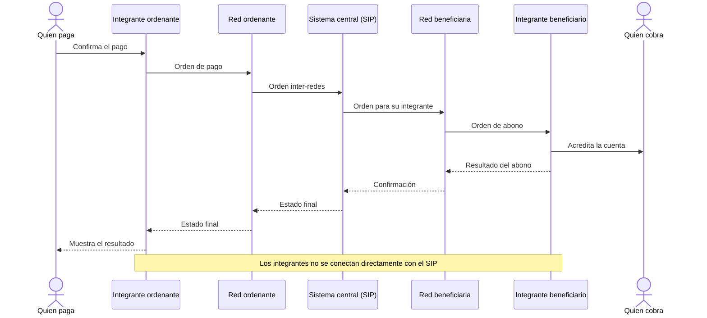
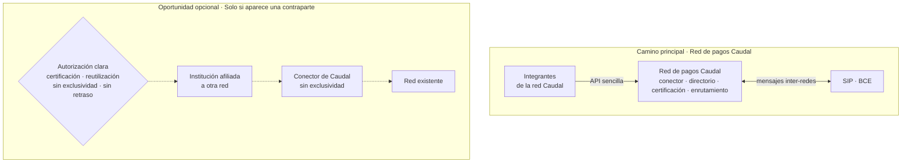

# Red de pagos Caudal — Infraestructura para el Sistema Integrador de Pagos del Ecuador

## Resumen ejecutivo

Ecuador ya definió la estructura de sus pagos en tiempo real. No será una sola plataforma a la que se conecten directamente todas las instituciones. Será un esquema **multi-red**: bancos, cooperativas, cajas centrales, mutualistas, SEDPES y otros integrantes se conectan a una **red de pagos**; las redes se conectan entre sí mediante el **Sistema Integrador de Pagos (SIP)** del BCE; y el BCE administra además el **Sistema Central de Llaves**, que garantiza que una llave sea única a escala nacional. Para los pagos intra-redes, las redes y sus integrantes deben implementar el estándar ISO 20022 hasta el **30 de noviembre de 2026** (BCE-GG-007-2026, disposición transitoria única).

Una red de pagos es una infraestructura administrada por una entidad autorizada, no una red de telecomunicaciones. Recibe y encamina mensajes, administra un directorio distribuido de llaves, certifica técnicamente a sus integrantes, procesa pagos intra-red y mantiene trazabilidad y continuidad las 24 horas, los 365 días. La norma dispone que este rol puede ser ejercido por un partícipe del Sistema Auxiliar de Pagos autorizado en el servicio de **compensación** (JPRM-2024-029-M, art. 18.1.2). Antes de conectar su red al SIP, la administradora debe obtener además la calificación técnica y operativa del BCE (BCE-GG-008-2025, art. 5).

Cada integrante necesita una capa de integración, también llamada _gateway_ o conector, que recibe instrucciones mediante una API sencilla, las traduce al estándar exigido y opera certificados, validaciones, trazabilidad y reportes. En la estrategia de Caudal, el **conector de Caudal** es la cara de entrada de la **red de pagos Caudal** y no abre cuentas ni custodia dinero de clientes. La misma tecnología podría conectarse a una red existente únicamente ante una oportunidad solicitada por una contraparte y con autorización, certificación y contrato claros.

La oportunidad aparece en tres segmentos:

1. **Fintech y SEDPES.** Son el primer mercado porque trabajan por API y necesitan acceso confiable al riel para ofrecer pagos, cobros y transferencias. Una fintech no se vuelve integrante por ser una empresa tecnológica: necesita ser SEDPE, neobanco, entidad financiera, procesador autorizado u otra categoría admitida. Las SEDPES están expresamente incluidas entre los integrantes y entre las entidades obligadas a implementar pagos con llaves (JPRM-2024-029-M, arts. 18.1.16 y 48.6). Además, el Catálogo Operacional les asigna una regla de liquidez particularmente exigente (§10, tabla 19), por lo que necesitan monitoreo y alertas antes de que el SIP bloquee sus pagos salientes.
2. **Cooperativas y cajas centrales.** Deben adaptar sistemas que muchas veces dependen de equipos pequeños o de un proveedor de core. Para ellas, el producto no es un archivo ISO 20022: es una operación completa, con soporte, continuidad, conciliación, seguridad y una consola que su personal pueda usar.
3. **Proveedores de core bancario.** Son el multiplicador. Una sola integración de su producto con el conector puede llevar el estándar a decenas de cooperativas sin exigir que cada una construya y mantenga la misma capa.

La estrategia tiene un solo objetivo: constituir y calificar la **red de pagos Caudal**. Desde el inicio, la sociedad operadora de Caudal tramita la autorización de compensación, construye directorio, certificación, enrutamiento y operación 24/7 y busca contratos con instituciones que quieran ser integrantes de esa red. El conector de Caudal (multiempresa) es la cara de integración de sus integrantes, no una etapa previa bajo una red incumbente.

Si durante ese recorrido una red existente o una institución solicita usar el conector de Caudal para facilitar su integración actual, la sociedad operadora puede evaluar la oportunidad. Solo se acepta si tiene autorización y contrato claros, no exige desarrollo a medida que distraiga la red Caudal y no impone exclusividad ni restricciones que dificulten que la institución elija esa red después. Es una venta oportunista, no un supuesto del plan ni una fuente de clientes asegurada.

Este modelo no depende de una hipótesis inédita. Empresas como STP en México, Celcoin y Transfeera en Brasil, y Minka en Colombia venden infraestructura para conectar empresas e instituciones a rieles nacionales. En conjunto muestran que una compañía de infraestructura puede atender desde cientos hasta miles de clientes y procesar decenas o cientos de millones de transacciones. Ecuador tiene una escala menor, pero la misma necesidad estructural: muchas instituciones deben conectarse a un estándar común y no todas pueden construir la capa por su cuenta.

Caudal aporta una base concreta, pero todavía no un servicio terminado. **Existe** el corpus público de investigación normativa, el modelo de dominio, las decisiones de arquitectura y el esqueleto del núcleo en Go. Está **diseñada** la familia de productos —conector de Caudal, red Caudal, sandbox, kit de conformidad y consolas— y la ruta de autorización. Está **por construir y demostrar** la operación de punta a punta, el conector de Caudal (multiempresa), el kit de conformidad, las consolas y la conectividad real al SIP. Esa separación importa: el activo actual es haber convertido una norma dispersa en un mapa técnico y operativo verificable; el siguiente activo será ejecutarlo.

## 1. El esquema que Ecuador está poniendo en marcha

### Conceptos mínimos

| Término                                     | Qué significa en este esquema                                                                                                                                                               |
| ------------------------------------------- | ------------------------------------------------------------------------------------------------------------------------------------------------------------------------------------------- |
| **Integrante**                              | Institución que presta el servicio al cliente final: banco, cooperativa, caja central, mutualista, SEDPE, neobanco, procesador autorizado u otra entidad contemplada por la norma.          |
| **Red de pagos**                            | Infraestructura privada o pública que conecta integrantes, procesa pagos intra-red, administra su directorio distribuido y certifica a sus miembros.                                        |
| **SIP**                                     | Sistema Integrador de Pagos administrado por el BCE. Procesa y compensa pagos entre redes y coordina las operaciones de llaves.                                                             |
| **RPI**                                     | Red de Pagos Instantáneos administrada por el BCE. Es una red dentro del esquema, no otro nombre del SIP.                                                                                   |
| **Llave**                                   | Identificador público —por ejemplo, celular, identificación, correo o alias alfanumérico— que permite encontrar las credenciales de la cuenta beneficiaria.                                 |
| **Partícipe del Sistema Auxiliar de Pagos** | Entidad autorizada por el BCE para uno o varios servicios regulados, como procesamiento, switch transaccional o compensación (JPRM-2024-018-M, arts. 22–23).                                |
| **Conector o gateway**                      | Software que integra el core de una institución con una red. Puede ser instalado por la institución o prestado como servicio alojado. No es, por sí solo, una red de pagos ni una licencia. |

### Cómo viaja un pago

El cliente trata con su banco, cooperativa o fintech; no trata con el SIP. En un pago entre dos redes, cada instrucción cruza dos integrantes y dos redes. El SIP ocupa el centro para la operación inter-redes. Las flechas siguientes representan **mensajes**, no dinero ni cuentas de clientes.

_El recorrido institucional de un pago inter-redes. Fuente conceptual: Catálogo Operacional, §§2 y 11.3._

El dinero del cliente permanece en las cuentas administradas por los integrantes. El SIP acumula obligaciones interinstitucionales en una malla y el BCE liquida las posiciones netas en las cuentas corrientes de los integrantes. Los pagos inter-redes los compensa el SIP; los intra-redes, cada red; ambos se liquidan en cuentas del BCE (JPRM-2024-029-M, arts. 48.14–48.15; Catálogo Operacional, §9).

### Qué cambia para las instituciones

La mensajería no es un cambio cosmético. El perfil usa mensajes ISO 20022, identificadores únicos, firmas y estados que distinguen recepción, irrevocabilidad y compensación. El pago debe completarse dentro de un techo de 20 segundos y una respuesta perdida puede dejar el resultado **por conciliar**, no simplemente rechazado. Esos casos deben resolverse el mismo día (Catálogo Operacional, §§5, 8, 11.3–11.4 y 13.2).

El esquema incorpora además un Sistema Central de Llaves y un directorio distribuido por red. El BCE garantiza la unicidad y orienta la consulta hacia la red correspondiente; la red mantiene la información necesaria para resolver la llave y debe conservarla sincronizada. Esto vuelve a la red responsable tanto del pago como del ciclo de vida y la consistencia de las llaves (JPRM-2024-029-M, arts. 48.11–48.13; Catálogo Operacional, §§3 y 12).

El **Catálogo Operacional** ya publica estados, tiempos, códigos de rechazo, tipos de llave, reglas de compensación y riesgo de liquidez. El **Catálogo Técnico**, que debe definir esquemas, validaciones campo por campo y otros detalles de conexión, todavía no está publicado. Por eso se puede construir la lógica y simular la contraparte, pero no afirmar que existe una integración final con el SIP.

## 2. La oportunidad por tipo de institución

### El problema no es que falte otra red

El Catálogo Operacional ya identifica cuatro redes —BANRED, COONECTA, ETIKO's y DEUNA—. La sociedad operadora de Caudal no puede atribuirse su posición institucional ni presumir que tiene integrantes o volumen antes de demostrarlo. Una institución escéptica tiene razón en preguntar por qué asumiría el costo y el riesgo de entrar a una quinta.

La respuesta no puede ser «porque la tecnología de Caudal es mejor». Una red nueva solo tiene espacio si resuelve un problema que las existentes no resuelven con suficiente velocidad, costo o calidad para un segmento concreto. Las hipótesis de Caudal son:

- **integración más sencilla:** una API estable y acompañamiento para que una fintech o cooperativa no tenga que construir sola el perfil ISO 20022;
- **certificación predecible:** pruebas automatizadas, resultados reproducibles y criterios visibles en lugar de proyectos de integración abiertos;
- **operación alojada:** certificados, monitoreo, conciliación y continuidad para instituciones sin equipo propio de pagos;
- **distribución mediante cores y cajas centrales:** una integración que llegue a varias cooperativas;
- **operación pensada para SEDPES:** alertas de liquidez y herramientas para su restricción particular;
- **transparencia y salida:** documentación pública, tarifas comprensibles y capacidad de migrar a otra operación sin rehacer el core.

Estas son **hipótesis comerciales**, no ventajas demostradas. Las redes actuales podrían mejorar su oferta, bajar precios o negar que exista el problema. También tienen economías de escala y confianza acumulada. La red nueva necesitaría demostrar una reducción material en tiempo de integración, costo total y carga operativa antes de pedir que una institución migre.

La decisión es además importante porque un integrante puede contratar el servicio de llaves con una red y el de credenciales con otra, pero no el mismo servicio simultáneamente con dos redes (Catálogo Operacional, §6). Cambiar de red exige coordinar contratos, certificación y migración del directorio; no es una prueba gratuita.

Mientras se tramita y construye la red Caudal, cuatro hitos deberían condicionar el aumento de inversión:

1. dos o tres instituciones dispuestas a firmar contratos condicionados a la autorización;
2. confirmación legal de la ruta de autorización y calificación como administradora;
3. un proveedor de core o caja central dispuesto a distribuir la membresía; y
4. evidencia de que el costo total y el tiempo de incorporación a la red Caudal mejoran de forma sustancial frente a las alternativas actuales.

### Fintech y SEDPES: entrar al riel sin convertirse en una empresa de infraestructura

Una fintech que todavía no tiene una categoría admitida puede comprar tecnología, pero no conectarse directamente como integrante. Para hacerlo necesita ser SEDPE, neobanco, entidad financiera, procesador autorizado u otra entidad contemplada por la norma. Una fintech autorizada quiere que los pagos sean una capacidad de su producto, no que todo su equipo se dedique a certificados, mensajes XML, conciliación y guardias operativas. Una SEDPE, además, puede mantener cuentas de pago electrónico y está dentro del perímetro regulado del esquema, pero debe separar los recursos de clientes, mantener reservas y encaje y cumplir las reglas aplicables de prevención de lavado (JPRM-2024-018-M, arts. 25, 31–34).

La conectividad alojada puede concentrar las tareas que se repiten en cada fintech:

- API sencilla para iniciar pagos, consultar estados y administrar llaves;
- traducción al perfil ISO 20022 exigido;
- administración segura de certificados y firmas;
- idempotencia, trazabilidad y conciliación de resultados desconocidos;
- sandbox y precertificación antes de conectarse;
- alertas de liquidez y reportería operativa.

La última capacidad es especialmente importante. El SIP compara el valor comprometido por una institución contra su saldo, encaje y nivel de riesgo. Cuando llega al umbral rojo, bloquea los pagos salientes y la rehabilitación requiere intervención del administrador del SIP. Para las SEDPES, el Catálogo asigna un encaje de 0,5 % y un factor de riesgo de 100 %; además, ordena añadir al encaje un porcentaje según su nivel de riesgo, cuya fórmula no se ha publicado (Catálogo Operacional, §10, tabla 19 y nota 6). Un tablero que avise antes del bloqueo no es un accesorio: protege la continuidad del producto fintech.

### Cooperativas y cajas centrales: cumplir sin multiplicar la complejidad

Las cooperativas sujetas a encaje aparecen entre las entidades obligadas a implementar pagos con llaves; las cajas centrales también están incluidas (JPRM-2024-029-M, art. 48.6). El desafío cambia según el tamaño. Una cooperativa grande puede operar su propio gateway. Una institución pequeña probablemente dependa de su caja central, federación o proveedor de core para recibir una solución alojada.

La necesidad no termina cuando sale el primer pago. Cada integrante debe sostener infraestructura y comunicaciones en tiempo real, informar tarifas y tiempos, atender fraude, errores y reclamos, operar 24/7, proteger datos y cumplir los procedimientos de su red (JPRM-2024-029-M, art. 48.8). Para una institución con pocas personas en tecnología, la propuesta útil combina:

- una integración que no exija construir ISO 20022;
- operación y monitoreo continuos;
- procedimientos de incidentes y continuidad;
- una consola para buscar pagos y trabajar conciliaciones;
- evidencia de auditoría y cumplimiento;
- una ruta de salida para no quedar cautiva del proveedor.

### Proveedores de core: una integración que se distribuye

El proveedor de core no tiene que convertirse en integrante ni en red para agregar valor. Puede integrar su producto con una API estable y distribuir esa capacidad entre sus clientes. La institución sigue siendo responsable de sus cuentas y de la relación con el usuario; el proveedor reduce el costo repetido de integración.

Este segmento tiene un efecto multiplicador: una integración bien mantenida puede servir a decenas de cooperativas. También reduce el riesgo operativo, porque las actualizaciones del estándar se resuelven en un punto común en vez de convertirse en decenas de proyectos independientes.

## 3. Un objetivo principal y una oportunidad opcional

_La red Caudal concentra la inversión y la ruta regulatoria. La conectividad para una red existente es una posibilidad lateral, sujeta a autorización, contrato y compatibilidad con ese objetivo._

### Camino principal: red de pagos Caudal

La norma aclara el punto de partida jurídico: puede administrar una red un partícipe del Sistema Auxiliar de Pagos previamente autorizado en **compensación** que procese transferencias de pago (JPRM-2024-029-M, art. 18.1.2). La autorización no agota el proceso. La red debe obtener la calificación técnica y operativa del BCE antes de conectarse al SIP (BCE-GG-008-2025, art. 5).

Como red, la sociedad operadora de Caudal asume:

- procesar pagos intra-red y requerimientos de resolución de llaves;
- integrar y certificar técnicamente a sus miembros;
- mantener infraestructura para operación continua;
- administrar y sincronizar su directorio distribuido;
- registrar la trazabilidad de pagos y operaciones de llaves;
- gestionar fraude, errores, reclamos y contingencias;
- mantener un manual vinculante para sus integrantes; y
- compensar operaciones intra-red y remitir los resultados para su liquidación en el BCE.

Estas funciones constan en JPRM-2024-029-M, arts. 48.10–48.15 y 48.19. Antes de la autorización se pueden vender software, sandbox, evaluación de brechas, precertificación y acompañamiento técnico, pero los contratos y el producto se diseñan para incorporar a la institución a la red Caudal cuando esté calificada.

### Oportunidad opcional: conectividad para una red existente

Una institución puede pedir que el conector de Caudal se conecte temporal o permanentemente a la red a la que ya pertenece. Eso no convierte a la sociedad operadora de Caudal en administradora de esa red: la red existente conserva el enrutamiento, el directorio, la certificación y su relación con el SIP.

La oportunidad solo se persigue cuando cumple simultáneamente cinco condiciones:

1. la institución o la red la solicita; la sociedad operadora de Caudal no depende de convencer a una incumbente;
2. la autorización aplicable y quién firma y responde por cada pago quedan confirmados;
3. la red existente acepta y certifica la conexión;
4. el contrato no contiene exclusividad, control de la relación comercial ni barreras para que la institución cambie de red; y
5. el trabajo reutiliza el producto de la red Caudal y no desplaza su expediente ni su construcción.

La regulación permite infraestructura de terceros y conexión indirecta, pero no obliga a BANRED, COONECTA, ETIKO's o DEUNA a aceptar el conector de Caudal, ofrecer una interfaz determinada o celebrar un acuerdo comercial. El principio de acceso justo y no discriminación (JPRM-2024-029-M, art. 48.3.f) no sustituye la certificación ni el contrato.

**[supuesto]** La combinación exacta de autorizaciones para operar el conector de Caudal hacia otra red depende de quién recibe la orden, firma el mensaje, mantiene la relación con la red y responde ante la institución. Si esas fronteras no pueden quedar fuera de una zona gris regulatoria y contractual, la oportunidad se rechaza.

## 4. Servicios posibles y momento en que se habilitan

| Servicio                                               |          Antes de autorización operativa |                                 Como partícipe autorizado |                                                      Como red autorizada |
| ------------------------------------------------------ | ---------------------------------------: | --------------------------------------------------------: | -----------------------------------------------------------------------: |
| Documentación, diagnóstico y sandbox                   |                                       Sí |                                                        Sí |                                                                       Sí |
| Precertificación y pruebas de conformidad no oficiales |                                       Sí |                                                        Sí | Sí; la red puede certificar a sus integrantes dentro del alcance del BCE |
| Software del conector de Caudal, autogestionado       |                                       Sí |                                                        Sí |                                                                       Sí |
| Operación alojada que procesa pagos para terceros      | No, salvo prueba expresamente autorizada | Sí, dentro de los servicios, medios y canales autorizados |                                                                       Sí |
| Enrutamiento como switch para partícipes               |                                       No |                            Sí, con autorización de switch |                                        Sí, dentro del alcance autorizado |
| Directorio distribuido de una red                      |                                       No |                     No por el solo hecho de ser partícipe |                                                                       Sí |
| Certificación regulada de integrantes de la red        |                                       No |                     No por el solo hecho de ser partícipe |                                                                       Sí |
| Compensación de operaciones intra-red                  |                                       No |                     Solo con autorización de compensación |                                                                       Sí |
| Custodia de fondos o cuentas de clientes               |                                       No |              No bajo procesamiento, switch o compensación |                       No; requeriría otro tipo de entidad y otro régimen |

La precertificación debe describirse con cuidado: un kit puede producir un informe técnico útil antes de la autorización, pero no debe presentarse como calificación del BCE ni como certificación oficial de una red que todavía no existe.

## 5. Qué exige operar este negocio

### Esfuerzo, tiempo y dinero

La norma no usa la categoría «red directa». Una empresa debe obtener autorización como partícipe en **compensación** para administrar una red y, después, la calificación técnica y operativa necesaria para conectarla al SIP (JPRM-2024-029-M, art. 18.1.2; BCE-GG-008-2025, art. 5).

El recorrido incluye, como mínimo:

1. constitución de la sociedad y definición del objeto social;
2. calificación previa como entidad auxiliar si se solicita procesamiento;
3. contratos con las instituciones o partícipes que recibirán el servicio;
4. expediente para procesamiento, switch y compensación, según el modelo aprobado;
5. revisión documental, debida diligencia y visita técnica;
6. acceso a la cámara de compensación especializada;
7. calificación técnica y operativa, pruebas y conexión al SIP; y
8. estabilización de la operación 24/7.

La JPRM-2024-018-M establece un término de 30 días para que el BCE autorice o niegue una solicitud una vez entregados los requisitos, y hasta 10 días para subsanar observaciones (art. 38). Ese reloj no incluye constituir la sociedad operadora de Caudal, conseguir contratos, obtener una calificación ante otro organismo, preparar la demostración ni completar la conexión técnica. La BCE-GG-024-2024 confirma la revisión, la debida diligencia y la visita, pero no publica una duración para la calificación técnica posterior (art. 12).

Por eso la meta interna de octubre de 2026 es **presentar un expediente completo**, no prometer una red en producción. El plan actual estima ocho semanas para preparar el expediente y doce para llegar a una demostración técnica **[est.]**; el plazo total hasta producción depende del BCE, del organismo de control y de documentos técnicos todavía pendientes.

Tampoco existe todavía un presupuesto validado con cotizaciones. El plan financiero interno reserva aproximadamente **USD 150.000** para trabajo legal y regulatorio y **USD 200.000** para infraestructura y seguridad de grado 24/7 **[est.]**, además de la nómina y el capital de operación. Son provisiones para planificar, no una tarifa del BCE ni una estimación cerrada. La principal partida recurrente será el equipo capaz de cubrir ingeniería, operación, seguridad, cumplimiento y atención continua; el cómputo por sí solo no es el costo dominante.

### Capa legal y societaria

Una empresa que realiza actividades fintech en Ecuador debe constituirse localmente —o registrar una sucursal—, tener objeto social específico y exclusivo para esas actividades y obtener la autorización de la autoridad competente (Ley Fintech, art. 7, citado en los considerandos de JPRM-2024-018-M). Los partícipes posibles y los siete servicios autorizables constan en JPRM-2024-018-M, arts. 22–23.

El expediente general ante el BCE exige, entre otros, RUC, documentos societarios, identificación de accionistas hasta personas naturales, estados financieros, plan de negocios, proyección financiera, esquema operativo, infraestructura, contratos críticos y políticas de riesgos, seguridad, continuidad, gobierno, atención y protección de datos. También exige certificado de cumplimiento de la UAFE (BCE-GG-024-2024, art. 3).

No todas las dependencias están resueltas. Para el servicio de procesamiento, la norma exige una calificación previa como entidad de servicios auxiliares del sistema financiero (BCE-GG-024-2024, art. 5.1). Debe confirmarse qué organismo la emite para la sociedad propuesta y cómo afecta el cronograma. La norma de autorización no fija expresamente un capital mínimo para procesamiento, switch o compensación; eso no demuestra por sí solo que no exista otro requisito financiero aplicable.

### Capa regulatoria y de cumplimiento

La autorización se otorga por servicios, medios y canales específicos. Prestar algo fuera de ese alcance puede llevar a la extinción del acto administrativo y a sanciones (JPRM-2024-018-M, arts. 37, 40–45). El BCE mantiene vigilancia y supervisión in situ y extra situ (BCE-GG-024-2024, arts. 15–18).

La protección de datos es central: cada mensaje puede contener identidad, documento y cuenta de ordenante y beneficiario. La sociedad operadora de Caudal necesita minimización, cifrado, segregación por cliente, acceso por roles, enmascaramiento y una bitácora que permita explicar cada acceso. El expediente exige una política conforme a la Ley Orgánica de Protección de Datos Personales (BCE-GG-024-2024, art. 3.22).

El certificado de la UAFE es requisito del expediente (BCE-GG-024-2024, art. 3.23), pero todavía debe precisarse si una administradora de red tiene obligaciones propias de monitoreo y reporte sobre el tráfico o si estas recaen principalmente en los integrantes. La respuesta cambia el equipo de cumplimiento y la arquitectura de monitoreo.

### Capa operativa

Operar 24/7 no significa únicamente mantener servidores encendidos. Una red debe:

- integrar y certificar miembros;
- vigilar conexiones, certificados y capacidad;
- conciliar resultados desconocidos antes del cierre diario;
- atender fraude, errores, quejas y reclamos;
- ejecutar continuidad y recuperación ante desastres;
- mantener trazabilidad y reportería;
- responder requerimientos de supervisión;
- sostener guardias y escalamiento humano.

Las administradoras deben prestar el servicio 24 horas al día, 365 días al año, certificar técnicamente a sus integrantes y contar con planes verificables de contingencia y continuidad (JPRM-2024-029-M, art. 48.10). El Catálogo Operacional añade tiempos, estados y el cierre diario de casos por conciliar (§§5, 11.4 y 13.2).

### Capa tecnológica

Las capacidades mínimas son:

1. **Conector de Caudal (multiempresa):** API estable, aislamiento por cliente, autenticación, idempotencia y traducción al perfil del esquema.
2. **Mensajería:** validación, firma, correlación, control de tiempos y manejo correcto de respuestas desconocidas.
3. **Directorio de llaves:** ciclo de vida, resolución, sincronización y conciliación con el Sistema Central de Llaves.
4. **Enrutamiento:** pagos entrantes, salientes e intra-red, sin convertir un timeout en un rechazo falso.
5. **Registro y auditoría:** reconstrucción de cada pago y de cada cambio operativo.
6. **Consola:** búsqueda de pagos, conectividad, certificados, conciliaciones y liquidez.
7. **Continuidad:** redundancia, despliegues sin interrupción, recuperación y pruebas periódicas.
8. **Seguridad:** cifrado en tránsito y reposo, autenticación fuerte, gestión de vulnerabilidades, monitoreo, continuidad, recuperación y trazabilidad (BCE-GG-008-2025, art. 10).

El problema principal no es el volumen. Es la corrección: saber cuándo un pago es irrevocable, evitar duplicados, preservar una llave durante una falla parcial y reconstruir lo ocurrido meses después. El diseño debe favorecer sistemas pequeños, auditables y operables por equipos reducidos.

## 6. Dónde está el dinero y quién responde

La operación no es puramente tecnológica, pero la administradora de la red tampoco se convierte en banco ni custodia fondos de clientes. La separación de responsabilidades es la siguiente:

| Función o riesgo | Integrante | Administradora de la red | BCE |
|---|---|---|---|
| Cuenta y saldo del cliente | Mantiene la cuenta, debita y acredita | No mantiene cuentas de clientes | No mantiene la relación comercial con el cliente |
| KYC del cliente | Identifica, vincula y monitorea a su cliente | No sustituye el KYC del integrante | Supervisa dentro de sus competencias |
| AML de la operación del cliente | Responsable principal según su régimen | Debe cumplir su propio perímetro; el alcance de reporte sobre el tráfico sigue por confirmar | BCE y UAFE ejercen las competencias correspondientes |
| Tesorería y liquidez | Mantiene recursos y gestiona su posición | Calcula posiciones, entrega información y puede alertar; no financia faltantes | Controla límites y liquida en las cuentas de los integrantes |
| Fraude y reclamos del cliente | Responde ante su cliente por autenticación, débito, crédito y atención | Opera controles, evidencia y procedimientos compartidos; la responsabilidad contractual por fallas está por definir | Supervisa y puede imponer medidas correctivas |
| Enrutamiento y disponibilidad | Mantiene disponible su conexión y su core | Responsable del enrutamiento, directorio, certificación y operación 24/7 | Responsable del SIP, Sistema Central de Llaves y continuidad central |
| Compensación | Aporta las operaciones y recibe su posición | Compensa operaciones intra-red | Compensa operaciones inter-red |
| Liquidación | Mantiene su propia cuenta corriente en el BCE | Remite las posiciones; no mantiene una bolsa común de dinero de los miembros | Debita y acredita las cuentas de cada integrante |

La regla decisiva está en JPRM-2024-029-M, arts. 48.14–48.15: cada red compensa sus operaciones intra-red, el SIP compensa las inter-red y ambas se liquidan en la cuenta corriente que **cada integrante** mantiene en el BCE. La norma no le asigna a la administradora una cuenta concentradora para reunir el dinero de los miembros ni la obligación de prefundar sus pagos con capital de la red. Sí necesita un registro exacto de obligaciones y posiciones para producir la compensación. Queda por confirmar si la cámara especializada exigirá garantías u otros recursos propios a la administradora.

La **tesorería** sigue siendo responsabilidad del integrante. Este debe mantener recursos suficientes y gestionar su cupo de liquidez. La red necesita vigilar estados, comunicar alertas y ayudar a reconstruir posiciones, pero no cubre déficits con dinero propio. Si una SEDPE o cooperativa alcanza el umbral rojo, el SIP bloquea sus pagos salientes; la red no puede levantar ese bloqueo por su cuenta (Catálogo Operacional, §10).

El **KYC y el monitoreo del cliente final** también pertenecen al integrante, que abre la cuenta y mantiene la relación contractual. La red ve datos personales y mensajes de pago, por lo que asume obligaciones fuertes de seguridad, acceso, protección de datos y trazabilidad. Además, debe contar con procedimientos para fraude, errores, quejas y reclamos y exigirlos a sus integrantes (JPRM-2024-029-M, art. 48.10). Sigue abierta la pregunta de si la administradora tiene deberes propios ante la UAFE para detectar y reportar operaciones inusuales que observa en el tráfico.

La responsabilidad final se reparte entre norma y contratos. El integrante responde por la cuenta, la autorización del cliente, el débito y el crédito. La administradora responde por su directorio, certificación, enrutamiento, disponibilidad, compensación y evidencia. El BCE responde por el SIP, la liquidación y la infraestructura central. Los contratos de adhesión deben convertir esa frontera en acuerdos de nivel de servicio, responsabilidades, escalamiento y manejo de controversias.

## 7. Prueba regional del modelo

Esta no es una comparación exhaustiva. Solo responde una pregunta: ¿hay empresas en la región que cobren por conectar instituciones y empresas a rieles de pago y alcancen escala relevante? La respuesta es sí.

| Empresa                | Escala aproximada publicada                                                                                                            | Ingreso o capital                                                | Tamaño publicado                         | Qué demuestra                                                                                                                               |
| ---------------------- | -------------------------------------------------------------------------------------------------------------------------------------- | ---------------------------------------------------------------- | ---------------------------------------- | ------------------------------------------------------------------------------------------------------------------------------------------- |
| **STP, México**        | Más de 1.500 empresas; declara atender al 98 % de las fintech mexicanas                                                                | No publica ingresos en las fuentes consultadas                   | No publicado de forma confiable          | La conexión empresarial al SPEI puede convertirse en infraestructura horizontal para casi todo un ecosistema fintech.                       |
| **Celcoin, Brasil**    | Más de 6.000 clientes y más de 400 millones de transacciones mensuales                                                                 | R$318 millones de ingreso recurrente anual en T1 2024 **[est.]** | Cerca de 370 personas en 2023 **[est.]** | Una plataforma modular de infraestructura financiera puede combinar pagos, banking y crédito y alcanzar cientos de millones de operaciones. |
| **Transfeera, Brasil** | Más de 1.200 empresas; más de 90 millones de transacciones acumuladas publicadas por la empresa                                        | R$27 millones de facturación en 2024 **[est.]**                  | No publicado de forma confiable          | Una empresa enfocada en pagos empresariales puede crecer desde la automatización por API hasta convertirse en participante directo de Pix.  |
| **Minka, Colombia**    | Transfiya procesaba unos 25 millones de transacciones mensuales en 2024; 20 instituciones conectadas y otras 20 en integración en 2022 | USD 27,5 millones levantados hasta 2022 **[est.]**               | Unas 30 personas en 2022 **[est.]**      | Un equipo pequeño puede construir y operar tecnología para un riel nacional y venderla a cámaras e instituciones.                           |

**Fuentes:** [STP](https://stp.mx/sobre-nosotros/) y [Mexico Business News](https://mexicobusiness.news/finance/news/driving-alternative-payments-mexico); [Celcoin](https://www.celcoin.com.br/sobre-a-celcoin/), [Exame](https://exame.com/negocios/aquisicoes-a-caminho-celcoin-capta-r-650-milhoes-para-buscar-oportunidades-de-mas/) y [TI Inside](https://tiinside.com.br/19/02/2024/celcoin-cresce-com-aposta-em-embedded-finance-e-banking-as-a-service/); [Transfeera](https://transfeera.com/) y [Monitor Mercantil](https://monitormercantil.com.br/transfeera-encerra-2024-com-faturamento-de-r-27-milhoes/); [Bloomberg Línea](https://www.bloomberglinea.com/2024/09/11/esta-fintech-colombiana-se-abre-espacio-en-africa-a-que-se-enfrenta/) y [TechCrunch](https://techcrunch.com/2022/04/27/bogota-based-minka-lands-24m-from-tiger-kaszek-to-build-an-open-infrastructure-for-money/).

Las cifras no son comparables como si todas las empresas vendieran el mismo producto. Sí permiten tres conclusiones prudentes:

1. las instituciones pagan por no construir solas la integración con el riel;
2. una licencia o participación más directa amplía el producto y fortalece la posición del proveedor; y
3. el negocio puede comenzar con equipos pequeños, aunque la operación regulada y 24/7 exige más estructura a medida que crece.

## 8. Qué aporta Caudal y qué falta

| Estado                       | Activo                                               | Evidencia actual                                                                                                                      |
| ---------------------------- | ---------------------------------------------------- | ------------------------------------------------------------------------------------------------------------------------------------- |
| **Existe**                   | Corpus regulatorio verificable                       | PDFs oficiales, transcripciones para búsqueda y análisis del Catálogo Operacional versionados en `research/bce/` y `docs/research/`.  |
| **Existe**                   | Modelo del sistema                                   | Arquitectura, modelo de datos, requisitos técnicos, decisiones de ledger y perfil de red documentados.                                |
| **Existe, en etapa inicial** | Núcleo en Go                                         | Módulos iniciales de ledger, compensación, tarifario y riesgo, más el binario `sip`; todavía no constituyen un pago de punta a punta. |
| **Diseñado**                 | Conector de Caudal, red Caudal, sandbox, kit de conformidad y consolas | Responsabilidades, límites y orden de construcción definidos en la documentación de producto y arquitectura.                |
| **Diseñada**                 | Ruta empresarial y regulatoria                       | Expediente desglosado, preparación técnica, preguntas legales y plan comercial dentro de este frente.                                 |
| **Por construir**            | Conector de Caudal (multiempresa) funcional          | API, aislamiento, mensajería y operación alojada demostrable.                                                                        |
| **Por construir**            | Sandbox y kit de conformidad                         | Red simulada de punta a punta e informes reproducibles de aprobación o falla.                                                         |
| **Por construir**            | Perfil de red y consola operativa                    | Directorio, membresía, certificación, enrutamiento, conciliación y operación diaria.                                                  |
| **Dependencia externa**      | Conexión real al SIP                                 | Catálogo Técnico, estándares de conexión, certificados, BIC y acceso a ambientes del BCE.                                             |

La experiencia técnica del fundador cubre sistemas contables de alto volumen, infraestructura financiera regulada como producto y operación de servicios financieros en la nube. Esa experiencia reduce el riesgo de diseño, pero no reemplaza las capacidades que la sociedad operadora de Caudal debe incorporar localmente: asesoría legal ecuatoriana, cumplimiento, operación 24/7, relación con el BCE y conocimiento comercial de fintech y cooperativas.

El proyecto abierto Caudal cumple una función distinta de su futura sociedad operadora. El software y el material de cumplimiento permanecen Apache-2.0; la sociedad puede cobrar por operación, alojamiento, certificación, integración y acuerdos de nivel de servicio. La autorización pertenece a la persona jurídica y no se obtiene por desplegar el repositorio.

## 9. Lo confirmado y las preguntas que todavía importan

### Confirmado por la norma

- Una administradora de red puede ser un partícipe autorizado en compensación que procesa transferencias de pago (JPRM-2024-029-M, art. 18.1.2).
- Cada red compensa sus operaciones intra-red y el BCE liquida las posiciones en cuentas corrientes de los integrantes (JPRM-2024-029-M, arts. 48.14–48.15).
- La red certifica técnicamente a sus integrantes, administra su directorio y opera 24/7 (JPRM-2024-029-M, arts. 48.10–48.13).
- Antes de conectarse al SIP, la red requiere calificación técnica y operativa del BCE (BCE-GG-008-2025, art. 5).
- El expediente de autorización exige capacidad societaria, financiera, operativa, tecnológica, de riesgos, seguridad y continuidad (BCE-GG-024-2024, arts. 3 y 9).

### Pendiente de respuesta o publicación

1. **Uso opcional del conector de Caudal hacia otra red.** Si aparece una oportunidad concreta, ¿qué combinación de procesamiento, switch y relación contractual permite operarla sin zona gris ni exclusividad?
2. **Calificación como auxiliar.** ¿Qué organismo debe calificar a la sociedad para prestar procesamiento y cuánto agrega al cronograma?
3. **Capital y garantías.** ¿Existe un requerimiento financiero adicional para compensación o para la cámara especializada que no consta en la norma general?
4. **Conexión al SIP.** ¿Qué transporte, certificados, direccionamiento, ambientes, pruebas y tiempos exige el estándar de conexión todavía no publicado?
5. **Liquidación intra-red en la práctica.** La norma define quién compensa y dónde se liquida; falta el procedimiento operativo y la interfaz para remitir posiciones.
6. **Liquidez de las SEDPES.** ¿Cómo se calcula el porcentaje adicional sobre su encaje y qué información estará disponible para alertas?
7. **Perímetro AML de la red.** ¿Qué deberes propios de monitoreo y reporte recaen sobre la administradora frente a los de sus integrantes?
8. **Alcance de la certificación.** ¿Qué pruebas define el BCE y qué parte puede establecer cada red para calificar a sus integrantes?

Tener estas preguntas no debilita el caso. Permite separar lo que ya puede construirse —modelo, directorio, enrutamiento, trazabilidad, operación y cara sur— de lo que debe resolverse con el BCE antes de producción.

## 10. Fuentes y criterio de lectura

Las fuentes regulatorias primarias están versionadas con URL, fecha y huella SHA-256 en [`research/bce/`](../../research/bce/README.md):

- JPRM-2024-018-M: partícipes, servicios y régimen general;
- JPRM-2024-029-M: arquitectura multi-red, integrantes, administradoras, compensación y obligaciones;
- BCE-GG-024-2024: expediente, autorización, visita, vigilancia y supervisión;
- BCE-GG-008-2025: integración, calificación técnica, seguridad y cronograma;
- BCE-GG-007-2026: mensajería y plazo del 30 de noviembre de 2026;
- Catálogo Operacional v1.0: estados, tiempos, llaves, flujos, compensación y riesgo de liquidez.

Ante cualquier diferencia, prevalece el PDF oficial. El resumen operativo de referencia está en [`docs/research/catalogo-operacional.md`](../../docs/research/catalogo-operacional.md); la lista detallada del expediente, en [`regulatory/dossier-psap.md`](regulatory/dossier-psap.md); y la arquitectura de una red, en [`docs/architecture/red.md`](../../docs/architecture/red.md).
